Most reviewers answer on their phone. The HITL app sends a push notification for each request and shows the question with the right controls for the answer type.

**Download:** [hitl.sh/download](https://hitl.sh/download) (App Store and Google Play).

## Sign in

Use **Continue with Apple**, **Continue with Google** or **Continue with email** (a one-time code). Use the same email you were invited with, so the workflows you were invited to are there.

<Frame>
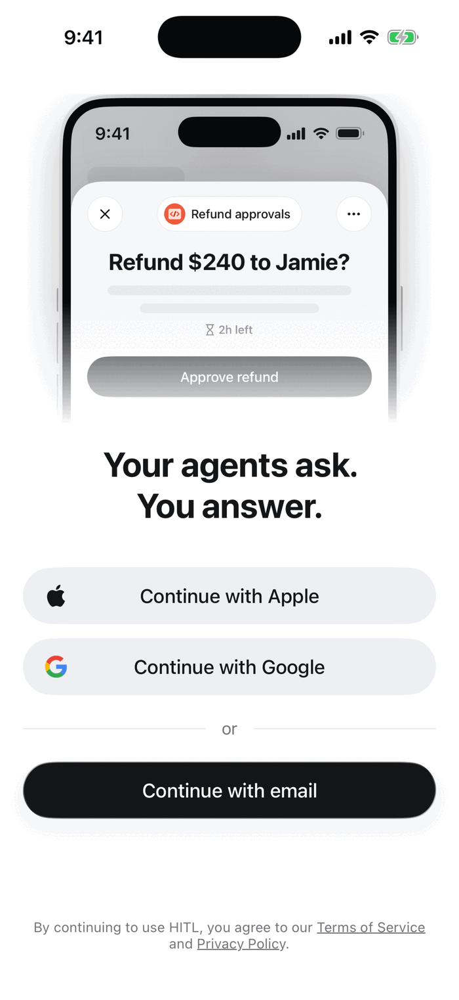
</Frame>

## Join a workflow

Accept the email invitation, tap an invite link (`hitl.sh/invites/...`), scan the workflow's QR code, or tap **+** on the **Workflows** tab and type the join code. You see the workflow's name, description and how many people review it, then tap **Join this workflow**.

<Columns cols={2}>
<Frame caption="Joining with a code">
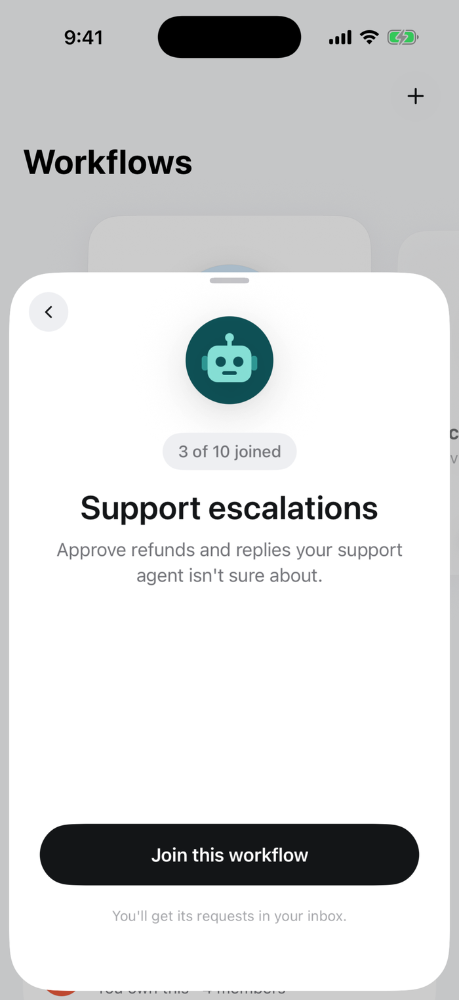
</Frame>
<Frame caption="Workflows you review">
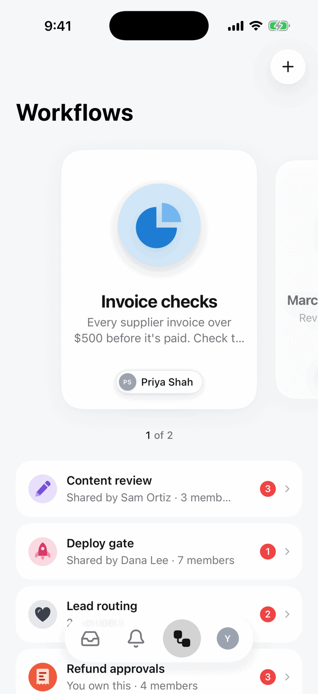
</Frame>
</Columns>

## Answer

The **Inbox** lists what is waiting for you, with the workflow, the question and the time left. Tap one to open it, answer, and tap **Submit**. The run continues straight away, and the app confirms your answer was sent.

<Columns cols={2}>
<Frame caption="Inbox">
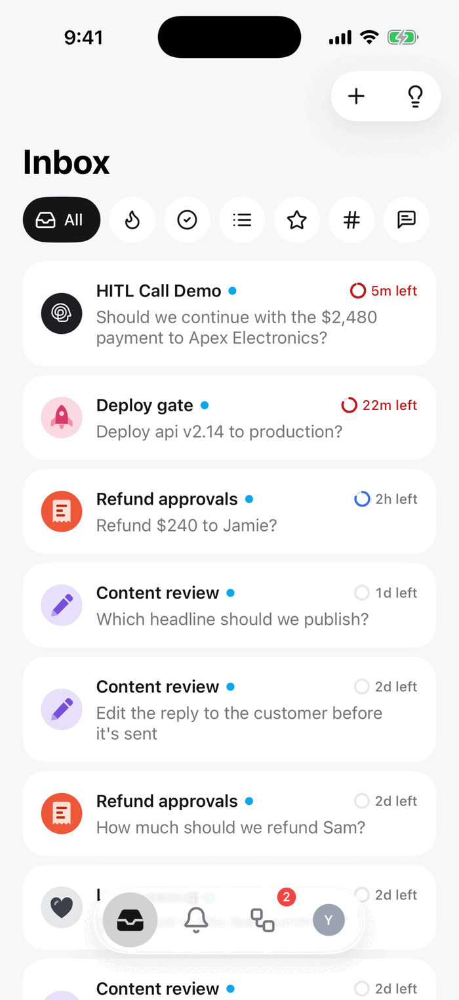
</Frame>
<Frame caption="After answering">
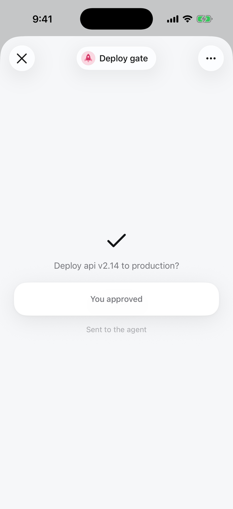
</Frame>
</Columns>

Each answer type has its own controls:

<Columns cols={3}>
<Frame caption="Approve / Deny">
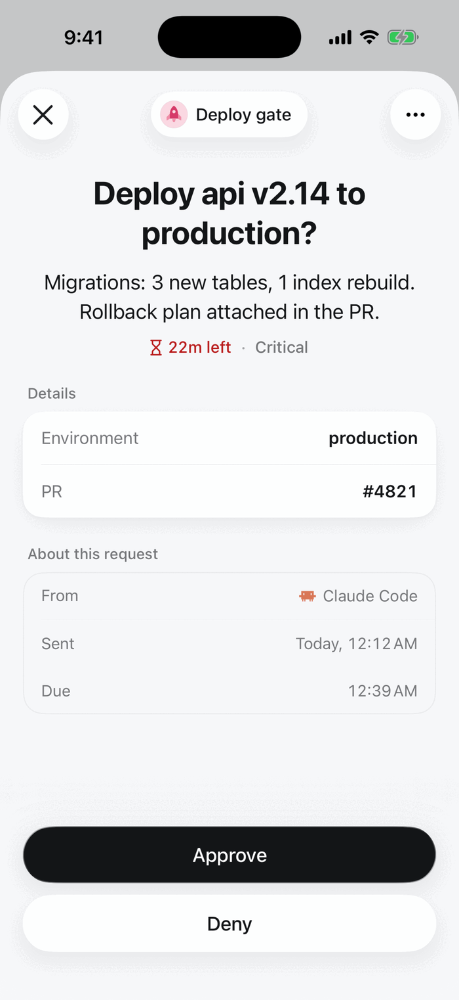
</Frame>
<Frame caption="Single choice">
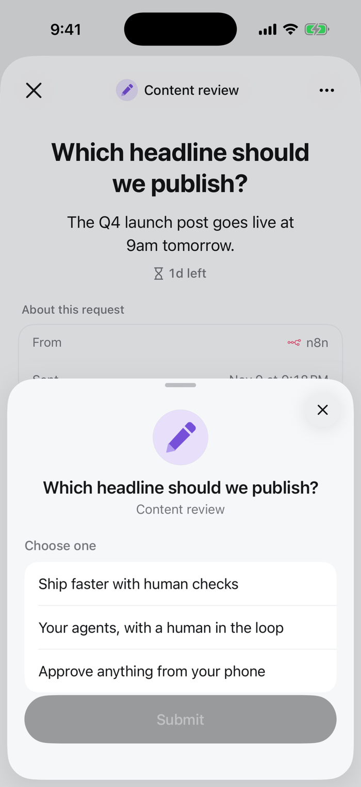
</Frame>
<Frame caption="Multiple choice">
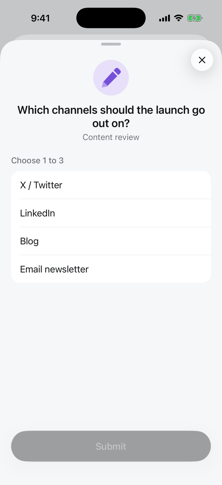
</Frame>
<Frame caption="Text">
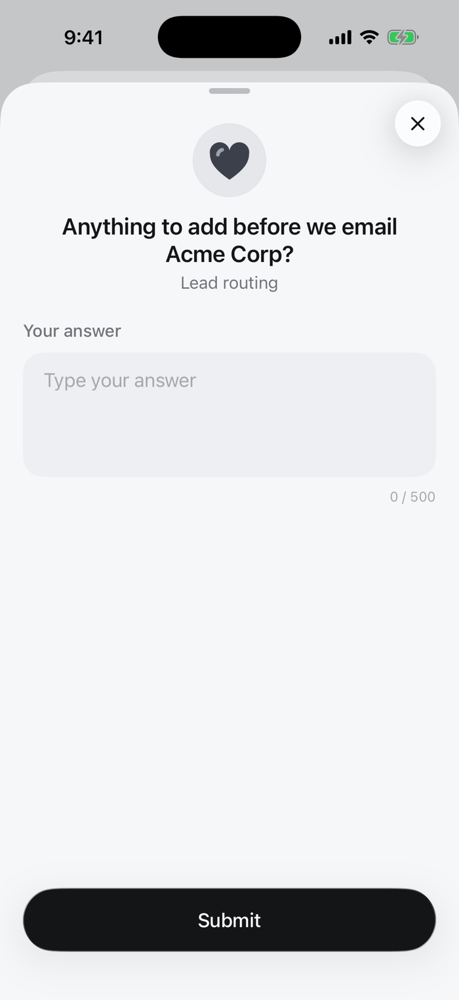
</Frame>
<Frame caption="Editable draft">
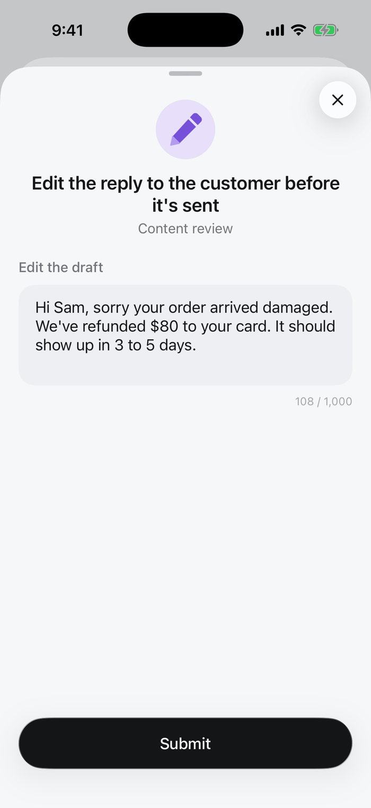
</Frame>
<Frame caption="Rating">
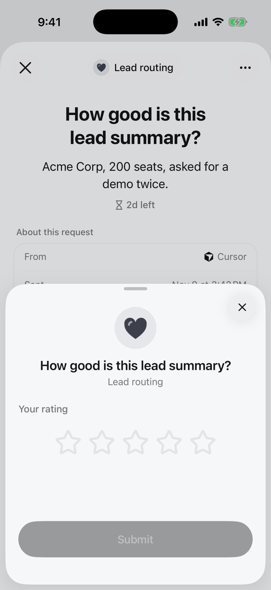
</Frame>
<Frame caption="Number">
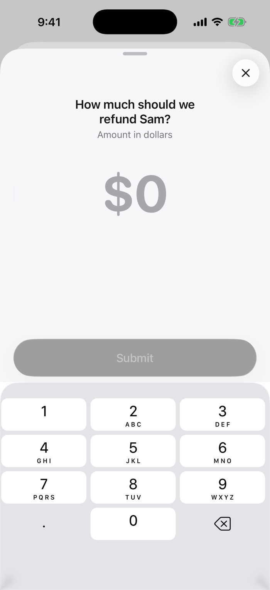
</Frame>
</Columns>

## History

The **Activity** tab lists what you and the other reviewers answered, by day.

<Columns cols={2}>
<Frame caption="Activity">
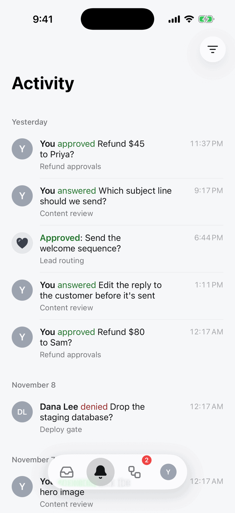
</Frame>
<Frame caption="Account">
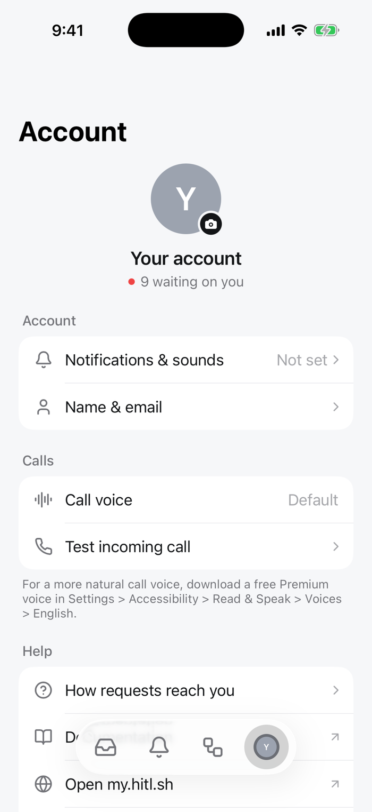
</Frame>
</Columns>

## Notifications and calls

Allow notifications when the app asks, or later in **Account → Notifications & sounds**. A review step can also **call** you for urgent requests: answer the call and say your decision. Set the voice under **Account → Calls**.
