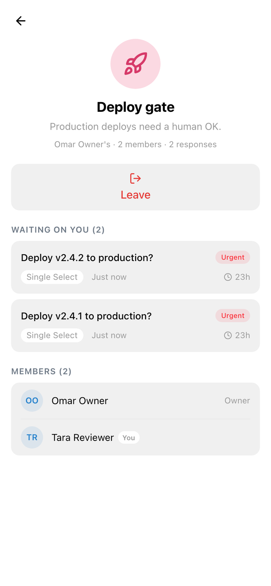
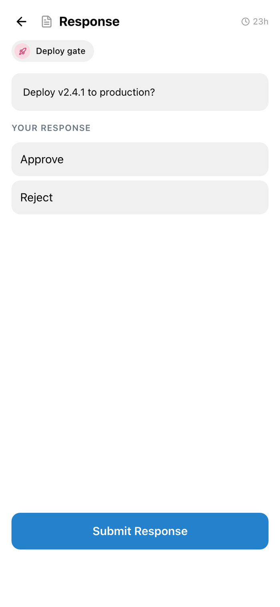
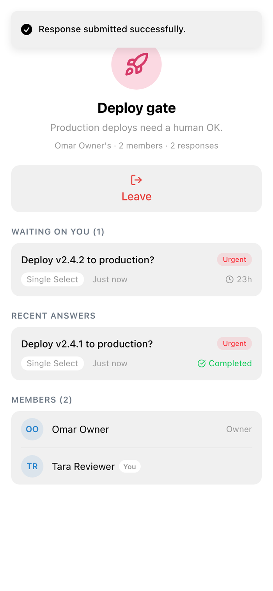
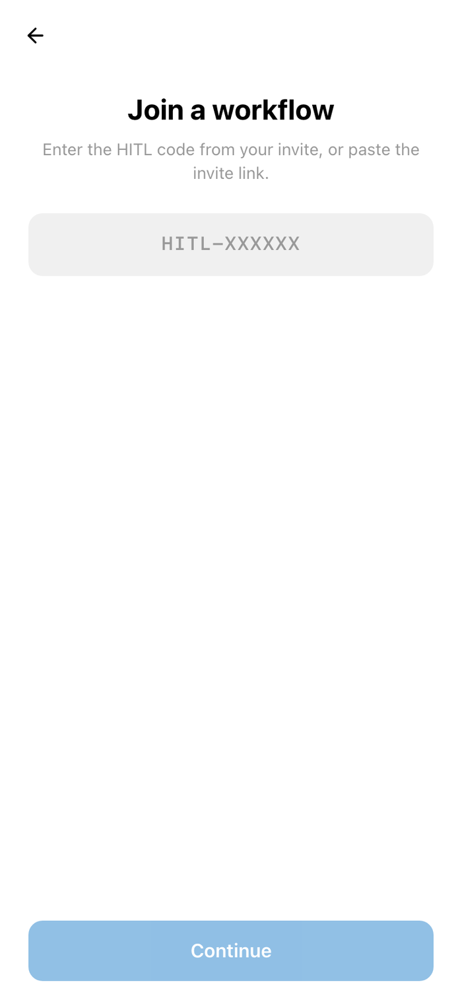
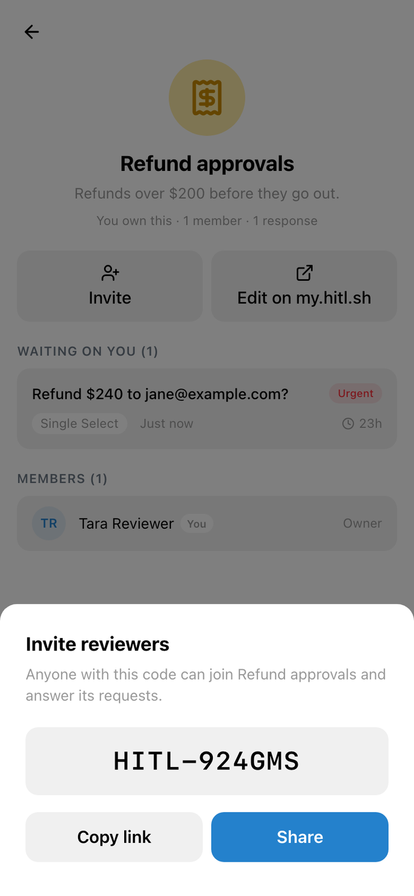

The HITL mini app runs inside Telegram, so reviewers can answer without installing anything else. A review step sends to Telegram when **Telegram** is on under **Send to** in its [Reviewers](/concepts/review-steps#reviewers) settings.

## Get started

Open [@Human_ApprovalBot](https://t.me/Human_ApprovalBot) in Telegram and launch the mini app. It signs you in with your Telegram account; if you already use HITL, sign in with your email once to link the two.

## Answer a request

The **Dashboard** lists what is waiting for you. Open a request, choose your answer under **Your response**, and tap **Submit Response**.

<Columns cols={3}>
<Frame caption="A workflow you review">

</Frame>
<Frame caption="Answering">

</Frame>
<Frame caption="Answered">

</Frame>
</Columns>

**History** shows everything you answered, with **Completed** and **Timed Out** filters.

## Join a workflow

On **Workflows**, tap **+**, enter the join code (`HITL-XXXXXX`) or paste the invite link, check the workflow and tap **Join this workflow**.

<Columns cols={2}>
<Frame caption="Enter the code">

</Frame>
<Frame caption="Check and join">

</Frame>
</Columns>

## Invite reviewers

On a workflow you own, **Invite** shows its join code with **Copy link** and **Share**, so you can send it to a Telegram chat. **Edit on my.hitl.sh** opens the editor.

<Frame>

</Frame>
