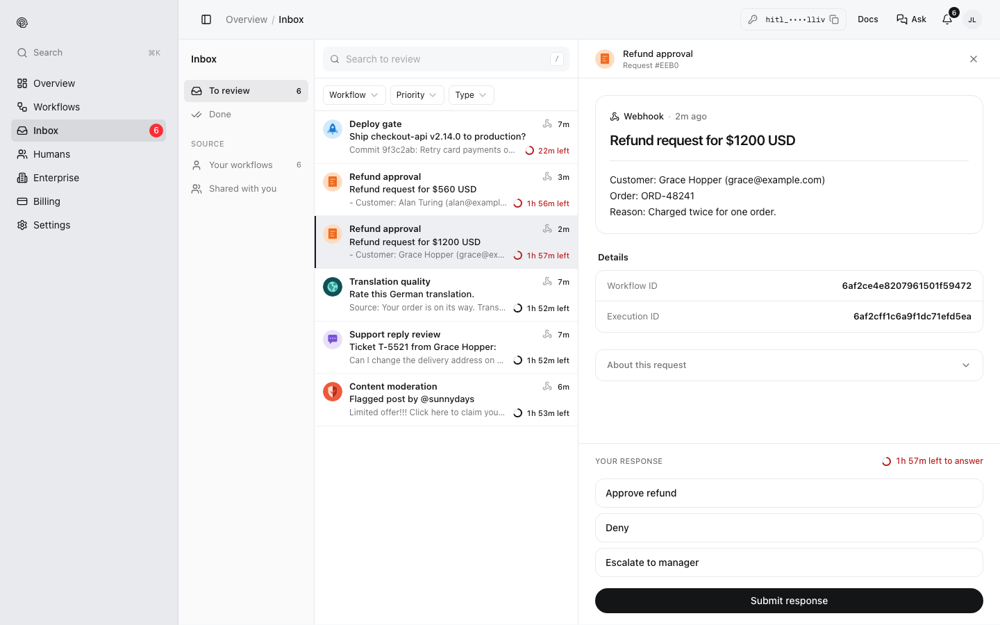
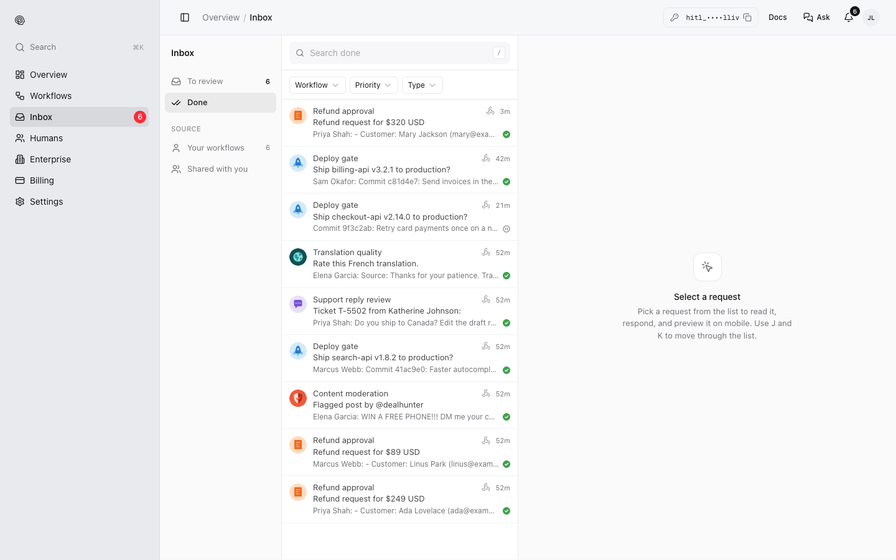

Every request sent to you is in the **Inbox** at [my.hitl.sh](https://my.hitl.sh), whatever other channels it also went to. The number next to Inbox in the sidebar is how many are waiting.

## Answer a request

<Steps>
<Step title="Open To review">
Requests waiting for you, newest first. Each row shows the workflow, the question's first line, who or what sent it and the time left before its deadline. Filter by **Workflow**, **Priority** or **Type**, or search. Under **Source**, choose **Your workflows** or **Shared with you**.
</Step>
<Step title="Pick one">
The question opens on the right with its details. Use <kbd>J</kbd> and <kbd>K</kbd> to move through the list.
</Step>
<Step title="Respond">
Under **Your response**, choose or type your answer and click **Submit response**. The time left is shown above it.

<Frame>

</Frame>
</Step>
</Steps>

The workflow continues as soon as you submit. If the review step asks one person, or everyone with first answer wins, the request disappears from the other reviewers' lists.

## What you answered

**Done** lists requests that have been answered, with the answer, who gave it and when.

<Frame>

</Frame>

## Other places to answer

- The [HITL mobile app](/answering/mobile-app) sends a push notification for each request.
- The [Telegram mini app](/answering/telegram) works inside Telegram.
