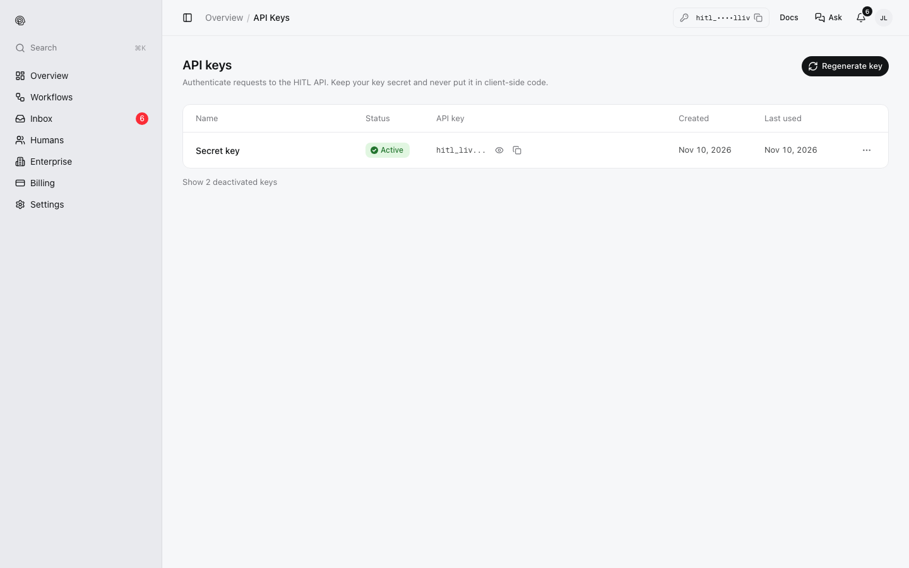

An API key lets code, agents and automations act as your account: list and run your workflows, read their executions, build workflows and invite reviewers. Keys look like `hitl_live_…`.

<Warning>
Treat the key like a password. Keep it in an environment variable (`HITL_API_KEY`) or a secret store, never in client-side code or a repository. The CLI and MCP server only ever send it to `hitl.sh` hosts.
</Warning>

## Get your key

Sign in at [my.hitl.sh](https://my.hitl.sh) and open **API keys** (also under **Settings → API keys**). Reveal or copy your key from the row's buttons.

<Frame>

</Frame>

**Regenerate key** issues a new key and deactivates the old one immediately. Update your integrations right away. **Show deactivated keys** lists previous keys.

## Let an agent get a key

An agent can sign you up without a browser, using your email:

```bash
npx -y @hitl-sh/cli signup --email you@example.com --agent-name "Claude Code"
# HITL emails you a 6-digit code and a Confirm link
npx -y @hitl-sh/cli signup confirm 123456
```

The key works at once, but until you confirm it can only read and draft workflows; anything else answers `403` with `"code": "confirmation_required"`. If your email already has an account, the confirmed key belongs to it (the email says so). Unconfirmed signups are deleted after a week. Over REST: [Sign up an agent](/api-reference/account/signup).

## Use it

Send it as a Bearer token:

```bash
curl https://api.hitl.sh/v1/test -H "Authorization: Bearer $HITL_API_KEY"
```

```json
{
  "error": false,
  "msg": "API key is valid",
  "data": {
    "api_key_id": "6af2ce9d8207961501f59493",
    "user_id": "6af2ce47967ce8777084a292",
    "email": "jordan.lee@example.com",
    "account_status": "active",
    "rate_limit": {"limit": 100, "remaining": 4988, "reset_at": "2026-11-10T09:00:00Z"}
  }
}
```

With the CLI: `npx -y @hitl-sh/cli whoami`.

## Where each tool reads it

| Tool | Setting |
|---|---|
| CLI, MCP server | `HITL_API_KEY`, or the key saved by `hitl login --api-key …` |
| n8n | A **HITL.sh Human Approval API** credential |
| Zapier, Make | The connection you create when adding the HITL app |
| Remote MCP (`https://mcp.hitl.sh/mcp`) | Signs in through the browser instead |

## Scopes

Keys issued with scopes need `workflow:read` (list, get, input, executions, humans), `workflow:run` (run, test, retry), `workflow:write` (create, edit, activate, pause, delete, publish) or `humans:write` (invitations, join codes). Keys without scopes, which includes the key in my.hitl.sh, have full access.
