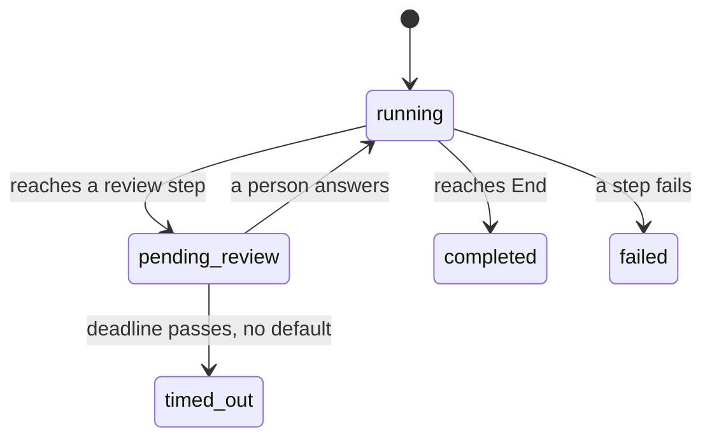
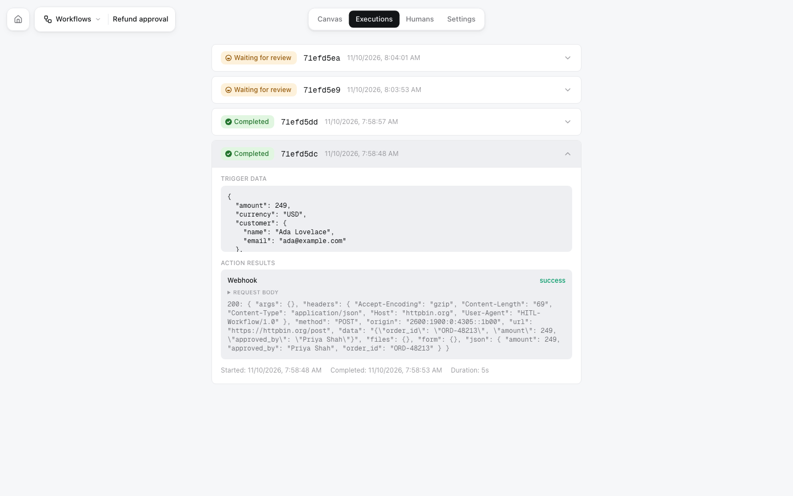

Every time a workflow starts, HITL creates an **execution**. It records the input, every step it passed, every decision people made and every action it took.

## Status



| Status | Meaning | `finished` |
|---|---|---|
| `running` | Steps are running | `false` |
| `pending_review` | Waiting for a person. `waiting_for` holds the question | `false` |
| `completed` | Reached End | `true` |
| `failed` | A step failed; `error` says why. It can be [retried](/api-reference/runs/retry) with the same input | `true` |
| `timed_out` | Nobody answered in time and there was no default answer | `true` |

## What an execution holds

A finished run of the refund workflow, from [`GET /executions/:id`](/api-reference/runs/get):

```json
{
  "id": "6af2ceb8c6a9f1dc71efd5dc",
  "workflow_id": "6af2ce4e8207961501f59472",
  "workflow_name": "Refund approval",
  "status": "completed",
  "finished": true,
  "input": {
    "order_id": "ORD-48213",
    "customer": {"name": "Ada Lovelace", "email": "ada@example.com"},
    "amount": 249,
    "currency": "USD",
    "reason": "Arrived with a cracked screen."
  },
  "result": "approve",
  "decisions": [
    {
      "node_id": "review-1",
      "reviewer_id": "6af2ce48967ce8777084a293",
      "reviewer_name": "Priya Shah",
      "platform": "web_portal",
      "decision": "approve",
      "responded_at": "2026-11-10T07:58:52.241Z",
      "response_time_seconds": 2.53
    }
  ],
  "action_results": [
    {
      "node_id": "action-1",
      "type": "webhook",
      "status": "success",
      "response": "200: {\"json\": {\"amount\": 249, \"approved_by\": \"Priya Shah\", \"order_id\": \"ORD-48213\"}}",
      "executed_at": "2026-11-10T07:58:53.482Z"
    }
  ],
  "trail": [
    {"node_id": "trigger-1", "status": "done", "at": "2026-11-10T07:58:49.604Z"},
    {"node_id": "review-1", "status": "waiting", "at": "2026-11-10T07:58:49.817Z"},
    {"node_id": "review-1", "status": "done", "at": "2026-11-10T07:58:53.482Z"},
    {"node_id": "condition-1", "status": "done", "at": "2026-11-10T07:58:53.482Z"},
    {"node_id": "action-1", "status": "done", "at": "2026-11-10T07:58:53.847Z"},
    {"node_id": "end-1", "status": "done", "at": "2026-11-10T07:58:53.847Z"}
  ],
  "triggered_via": "api",
  "callback_url": "https://example.com/hitl/result",
  "callback": {"state": "delivered", "attempts": 1, "last_status": 200},
  "started_at": "2026-11-10T07:58:48.493Z",
  "completed_at": "2026-11-10T07:58:53.847Z",
  "duration_seconds": 5.354
}
```

- `result`: the last decision. `decisions`: every review step's answer, with the reviewer's name (never their email) and where they answered (`mobile`, `web_portal`, `telegram`, ...).
- `action_results`: what each action step got back, starting with the status code.
- `trail`: the path the run took.
- `triggered_via`: `api`, `webhook`, `email`, `schedule`, `manual` or `test`.

In my.hitl.sh, the same run is on the workflow's **Executions** tab:

<Frame>

</Frame>

## Getting the result

<Tabs>
<Tab title="Wait / poll">
`GET /executions/:id?wait=30` answers as soon as the run has finished, or after 30 seconds with the run as it is (max 60). Call it again until `finished` is `true`. One call covers up to a minute, so this is cheap.

```bash
curl "https://api.hitl.sh/v1/api/executions/6af2ceb8c6a9f1dc71efd5dc?wait=60" \
  -H "Authorization: Bearer $HITL_API_KEY"
```

The CLI's `hitl run <id> --wait` and the MCP tool `get_execution` with `wait` do this for you.
</Tab>
<Tab title="Callback URL">
Pass `callback_url` when you start the run. When it finishes (completed, failed or timed out), HITL POSTs the run there once:

```json
{
  "event": "execution.finished",
  "execution": { "id": "6af2ceb8c6a9f1dc71efd5dc", "status": "completed", "result": "approve", "decisions": [ ... ], "...": "..." }
}
```

Signed, retried for 24 hours. See [Webhooks](/guides/webhooks).
</Tab>
<Tab title="Webhook subscription">
Subscribe a URL to a workflow and every run that finishes is sent to it, however it was started:

```bash
curl -X POST https://api.hitl.sh/v1/api/webhooks/subscribe \
  -H "Authorization: Bearer $HITL_API_KEY" -H "Content-Type: application/json" \
  -d '{"webhook_url": "https://example.com/hitl", "events": ["execution.finished"], "workflow_id": "6af2ce4e8207961501f59472"}'
```

Same body and signature as a callback. See [Webhooks](/guides/webhooks).
</Tab>
<Tab title="Live">
`POST /executions/:id/live` (or `"live": true` on the run) returns a URL and token to watch the run update in real time over [Statewire](https://www.harness-sdk.dev/statewire/docs). The CLI's `hitl run <id> --watch` uses it. See [Watch a run live](/api-reference/runs/live).
</Tab>
</Tabs>

## Limits

- Input: up to 64 KB of JSON per run.
- `/workflows` and `/executions` routes: 1,000 requests an hour per API key.
- `wait`: up to 60 seconds per call.
