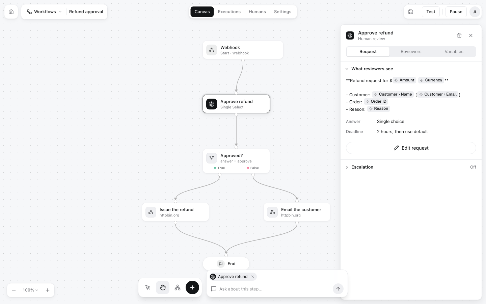
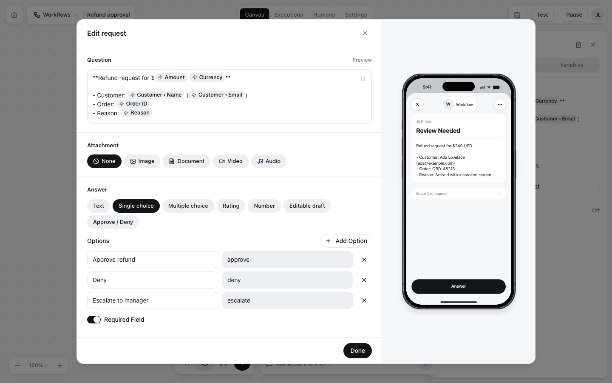
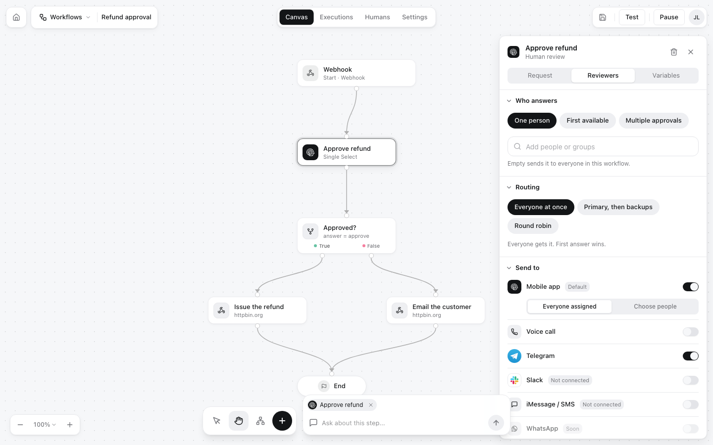

A **review step** (Human Review in the editor) pauses the run, sends a question to people, and continues with their answer. A workflow can have several, one after another or on different branches, for example a second approval for large amounts.

Select a review step on the canvas to see its settings. The panel has three tabs: **Request**, **Reviewers** and **Variables**.

<Frame>

</Frame>

## The request

Click **Edit request** to change what reviewers see:

<Frame>

</Frame>

| Setting | What it is |
|---|---|
| **Question** | Markdown. Insert input fields as chips, such as *Amount* (`{{trigger.body.amount}}`), and earlier results such as `{{ai.result}}`. The phone preview on the right shows it filled in with the trigger's test payload |
| **Attachment** | None, or an **Image**, **Document**, **Video** or **Audio** file shown with the question. See [Content](/responses/content-types) |
| **Answer** | The [answer type](/responses/types) and its settings: Approve / Deny, Single choice, Multiple choice, Text, Editable draft, Rating or Number |
| **Required** | Whether the reviewer must answer to submit |
| **Deadline** | *Respond within* a number of hours, *then* use a default answer (or let the run time out) |
| **Urgent** | Marks the request as urgent on reviewers' phones |

### What the answer looks like

The execution records each answer in `decisions` and the last one in `result`:

| Answer type | `decision` / `result` |
|---|---|
| Approve / Deny | `true` or `false` |
| Single choice | The option's value, such as `"approve"` |
| Multiple choice | A list of values, such as `["x", "linkedin"]` |
| Text, Editable draft | The text |
| Rating, Number | A number |

## Reviewers

<Frame>

</Frame>

| Setting | Choices |
|---|---|
| **Who answers** | **One person**, **First available**, or **Multiple approvals** (several people must answer) |
| **People or groups** | Pick people and groups from your [humans](/concepts/reviewers). Left empty, the request goes to everyone on the workflow |
| **Routing** | **Everyone at once** (first answer wins), **Primary, then backups**, or **Round robin** |
| **Send to** | **Mobile app** (push notification, the default), **Telegram**, **Voice call**, and Slack or iMessage / SMS once connected. The [web inbox](/answering/web-inbox) always has it |

## Escalation

With **Escalation** on, a request nobody answers in time goes to someone else instead of timing out.

## What the run looks like while it waits

While a review step waits, the execution is `pending_review` and `waiting_for` holds the question as reviewers see it:

```json
{
  "status": "pending_review",
  "current_step": {"node_id": "review-1", "type": "review", "label": "Approve refund"},
  "waiting_for": {
    "request_id": "6af2cf08933b51a96f13eeae",
    "status": "pending",
    "request_text": "**Refund request**\n\n| | |\n|---|---|\n| Customer | Grace Hopper (grace@example.com) |\n| Order | ORD-48241 |\n| Amount | $1200 USD |\n\n**Reason:** Double charged for one order.",
    "response_type": "single_select",
    "response_config": {
      "options": [
        {"label": "Approve refund", "value": "approve"},
        {"label": "Deny", "value": "deny"},
        {"label": "Escalate to manager", "value": "escalate"}
      ],
      "required": true
    },
    "timeout_at": "2026-11-10T10:00:08.186Z"
  }
}
```

<CardGroup cols={2}>
<Card title="Answer types" icon="shapes" href="/responses/types">Settings for each kind of answer</Card>
<Card title="Reviewers" icon="users" href="/concepts/reviewers">People, groups, invitations and join codes</Card>
</CardGroup>
