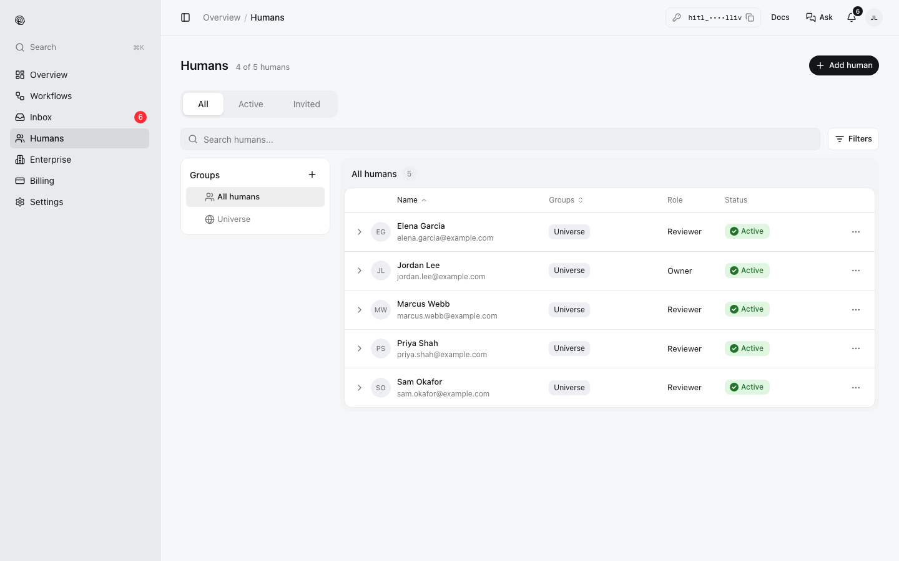
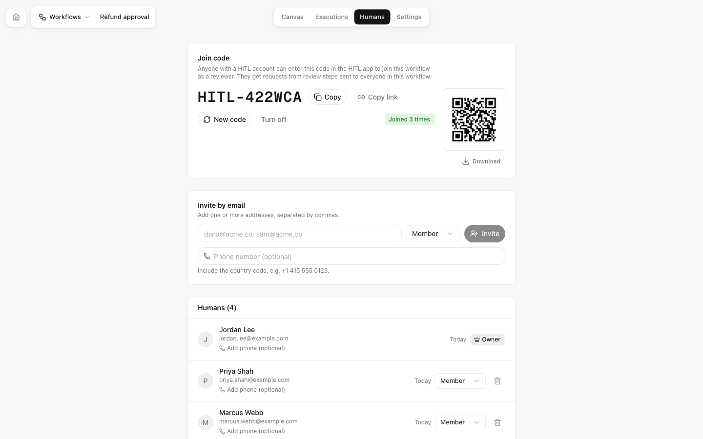
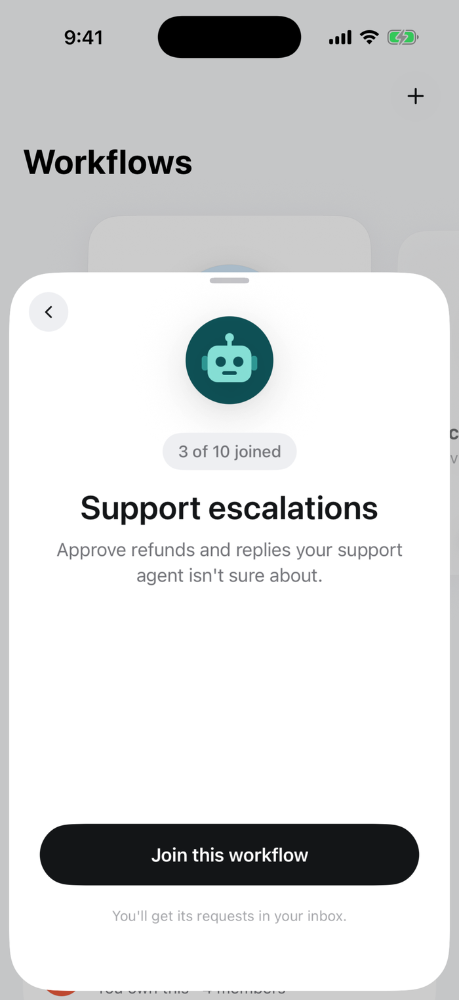
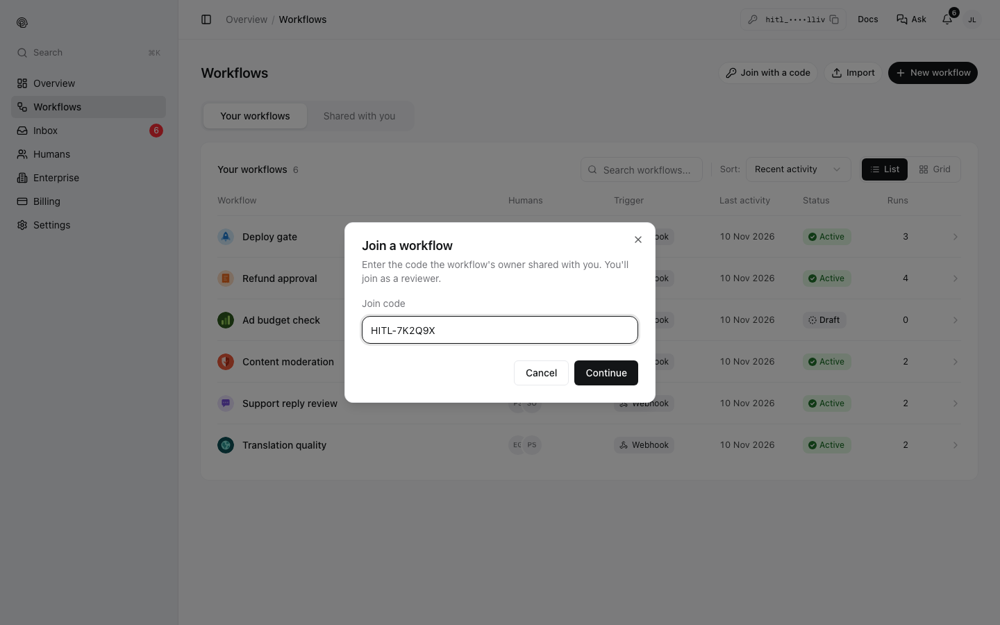

**Reviewers** are the people a workflow asks. Anyone with a HITL account can be one; they answer in the [mobile app](/answering/mobile-app), the [web inbox](/answering/web-inbox) or [Telegram](/answering/telegram).

## Humans, groups and workflow reviewers

- **Humans** (in the sidebar of my.hitl.sh) is your directory: everyone you have invited, with their status (*Active* or *Invited*) and role.
- **Groups** sort them, for example *Support leads* or *On-call*. Everyone is in the default group, **Universe**. A review step can ask a group instead of naming people.
- Each workflow has its own **reviewers**, on its **Humans** tab. A review step with no people picked asks all of them.

<Frame>

</Frame>

## Inviting reviewers to a workflow

Open the workflow, then its **Humans** tab.

<Frame>

</Frame>

| Way | How it works |
|---|---|
| **Email** | Type one or more addresses and click **Invite**. Each person gets an email; people without an account create one from it. Add a phone number to reach them by voice call |
| **Join code** | A code such as `HITL-422WCA`. Anyone with a HITL account enters it in the app (or in my.hitl.sh under **Workflows → Join with a code**) and joins as a reviewer |
| **Link** | **Copy link** gives `https://hitl.sh/invites/HITL-422WCA`: on a phone it opens the app, on a computer it opens my.hitl.sh |
| **QR code** | Scan it with the phone's camera or in the app. **Download** saves it as an image to print or share |

**New code** replaces the code (the old one stops working); **Turn off** disables joining by code. People who already joined stay.

From code: [`POST /workflows/:id/invitations`](/api-reference/reviewers/invite) and the [join code endpoints](/api-reference/reviewers/join-code), or the MCP tools `invite_to_workflow` and `create_workflow_join_code`.

## Joining as a reviewer

<Columns cols={2}>
<Frame caption="iOS: open the code or link, then Join this workflow">

</Frame>
<Frame caption="my.hitl.sh: Workflows, Join with a code">

</Frame>
</Columns>

Workflows you review appear under **Shared with you** in my.hitl.sh and in the app's **Workflows** tab. You can leave a workflow from its page in the app.

## Roles

| Role | Can |
|---|---|
| **Owner** | Everything: build, run, invite, see executions. One per workflow |
| **Admin** | Answer, and help manage the reviewers |
| **Member** | Answer the requests sent to them |

## Plan limits

Your plan sets how many humans you can have (3 on Free and Starter, 5 on Pro). See [Billing](/billing).
