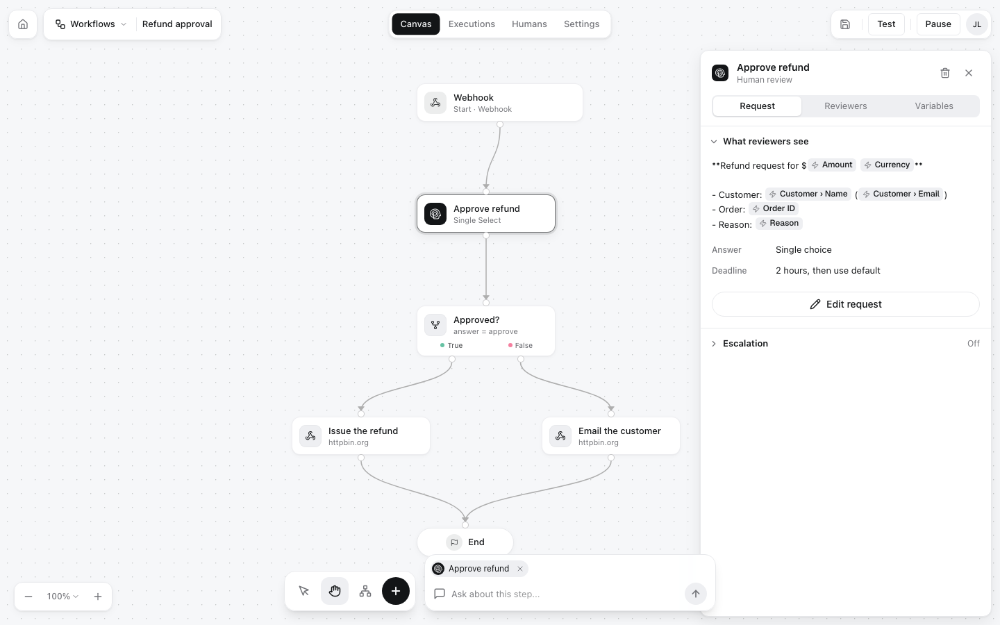

Everything in HITL is a **workflow**: a graph that starts at a **trigger**, runs through **steps**, and finishes at **End**. Each time it starts, HITL creates an [execution](/concepts/executions) that records what happened at every step.

<Frame>

</Frame>

The workflow above, step by step:

1. **Webhook** (trigger): the run starts with an order: `{"order_id": "ORD-48213", "amount": 249, "customer": {...}, "reason": "..."}`.
2. **Approve refund** (review step): a support lead gets *"Refund request for $249 USD…"* and picks *Approve refund*, *Deny* or *Escalate to manager*.
3. **Approved?** (condition): `response.value equals approve`.
4. **Issue the refund** or **Email the customer** (actions): webhooks to your systems, with the order and who approved it.
5. **End**.

## Triggers

The trigger is how a run starts. Every workflow has exactly one, and every workflow can also be run from the [API](/api-reference/runs/run), the CLI, MCP, n8n, Zapier and Make whatever its trigger is.

| Trigger | Starts a run when |
|---|---|
| **Webhook** | Something POSTs JSON to the workflow's webhook URL (shown on the trigger and in **Settings**) |
| **Email** | An email arrives at the workflow's address |
| **Schedule** | A time you set comes round |
| **Manual** | You click run in the editor |
| **Google Sheets** | A row is added to a sheet |

Whatever starts the run, its data is the **input**, and steps read it as `{{trigger.body.<path>}}`: `{{trigger.body.customer.email}}` reads `customer.email`. [`GET /workflows/:id/input`](/api-reference/workflows/input) lists every field the steps read, which is how n8n, Zapier and Make build their input forms.

## Steps

| Step | What it does |
|---|---|
| **Human Review** | Asks people and waits for their answer. See [Review steps](/concepts/review-steps) |
| **AI** | Runs a prompt, for example to draft a reply for a person to edit. Its output is `{{ai.result}}` |
| **AI Classifier** | Sorts the input into categories you name |
| **Data** | Fetches data from Google Sheets, an API or a table |
| **Condition** | Branches on a value: `equals`, `not_equals`, `contains`, `not_contains`, `greater_than`, `less_than`, `exists`, `not_exists`. It has a **True** and a **False** exit |
| **Transform** | Sets variables for later steps |
| **Action** | Does something: a webhook, an email, a Slack or Telegram message, a Google Sheets row and more. What it sent and got back is kept in the execution's `action_results` |
| **End** | Every path finishes here |

After a review step, later steps can read the answer as `{{response.value}}` and who gave it as `{{response.by.name}}`.

## Status

| Status | Meaning |
|---|---|
| `draft` | Being built. It cannot run yet |
| `active` | Live: its trigger works and `POST /run` starts it |
| `paused` | Stopped. Runs already waiting for a person keep waiting |

**Activate** checks the workflow first (for example that each review step has a question and an answer type) and says what to fix. Publishing keeps numbered versions of an active workflow ([revisions](/api-reference/workflows/revisions)).

## Who can see a workflow

The account that owns a workflow builds it, runs it and sees its executions. The people it asks are its [reviewers](/concepts/reviewers): they see the questions it sends them and the workflow's name and icon, not its executions or settings. An API key acts as its account: it sees and runs the workflows that account owns.

## Building workflows without the editor

The editor and the API build the same graph. An agent can create one with [`POST /workflows`](/api-reference/workflows/create) (or the MCP tool `create_workflow`), invite reviewers, and activate it:

```json
{
  "name": "Refund approval",
  "nodes": [
    {"id": "trigger-1", "type": "trigger", "position": {"x": 0, "y": 0}, "data": {"triggerType": "webhook"}},
    {"id": "review-1", "type": "review", "position": {"x": 0, "y": 200}, "data": {
      "label": "Approve refund",
      "requestText": "Refund ${{trigger.body.amount}} to {{trigger.body.customer.name}}?",
      "responseType": "single_select",
      "responseConfig": {"options": [{"value": "approve", "label": "Approve refund"}, {"value": "deny", "label": "Deny"}]},
      "timeout": "7200"
    }},
    {"id": "end-1", "type": "end", "position": {"x": 0, "y": 400}, "data": {"label": "End"}}
  ],
  "edges": [
    {"id": "e1", "source": "trigger-1", "target": "review-1"},
    {"id": "e2", "source": "review-1", "target": "end-1"}
  ]
}
```

<CardGroup cols={2}>
<Card title="Workflow editor" icon="pen-ruler" href="/guides/workflow-editor">Build one step by step</Card>
<Card title="Executions" icon="list-check" href="/concepts/executions">What a run records and how you get its result</Card>
</CardGroup>
