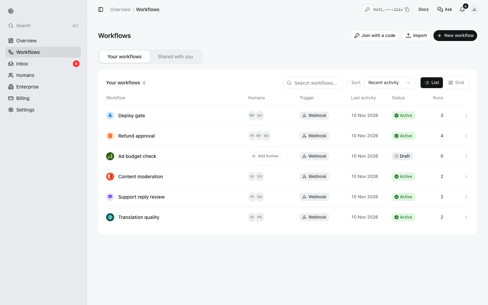
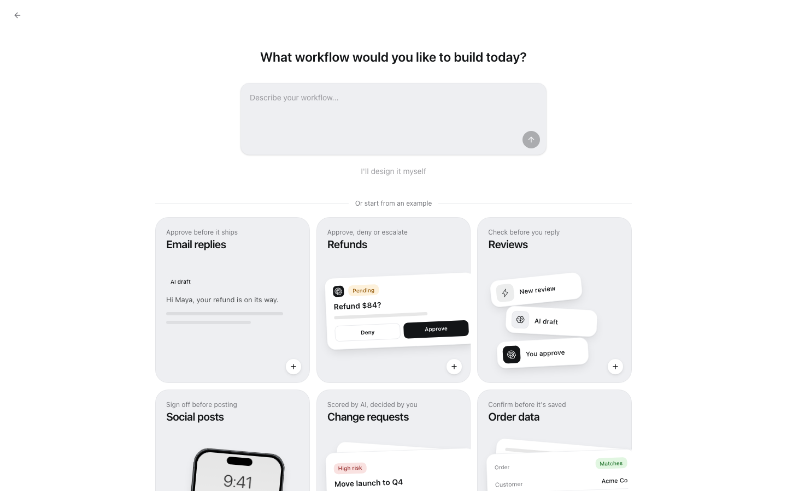
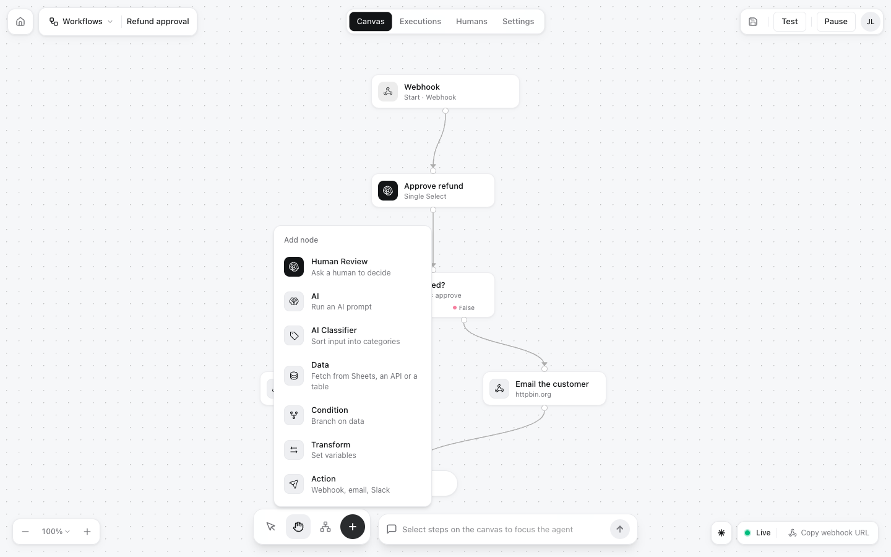
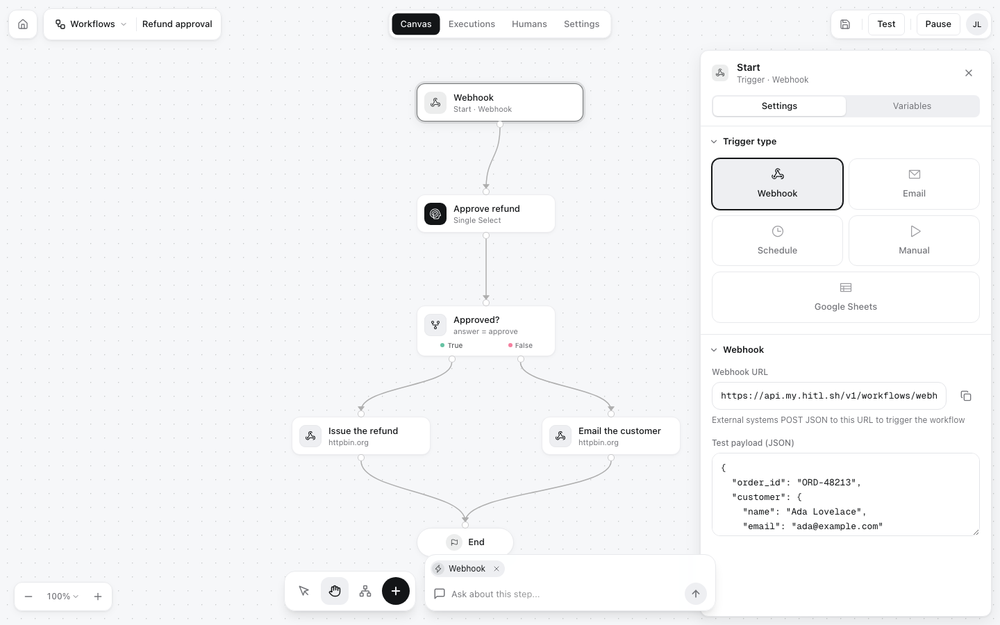
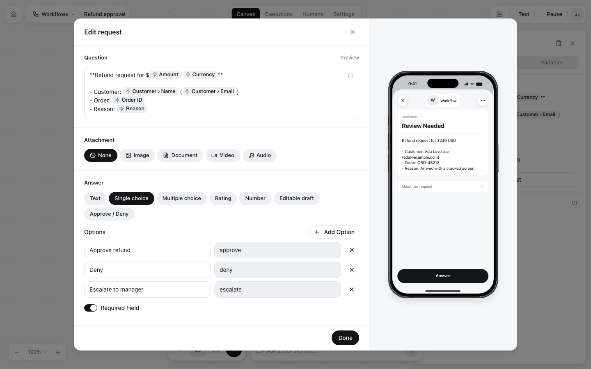
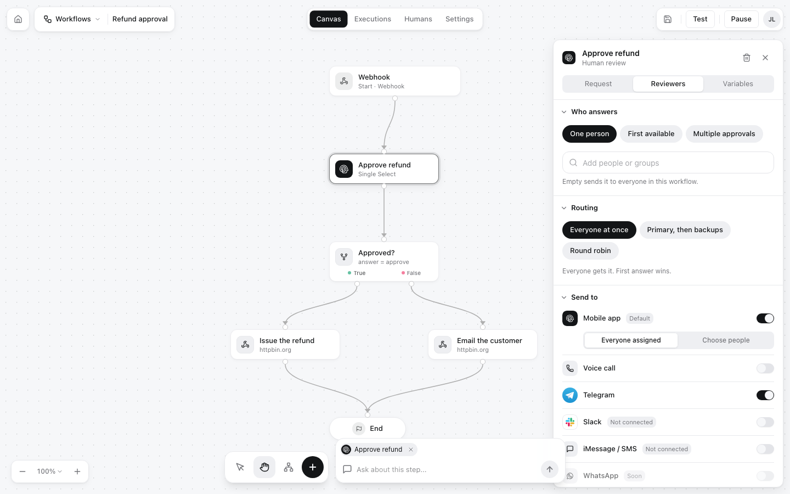
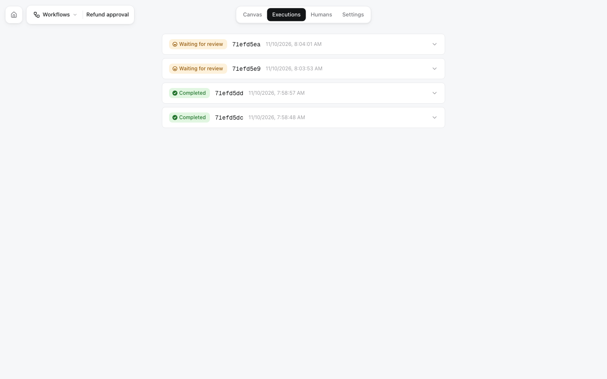
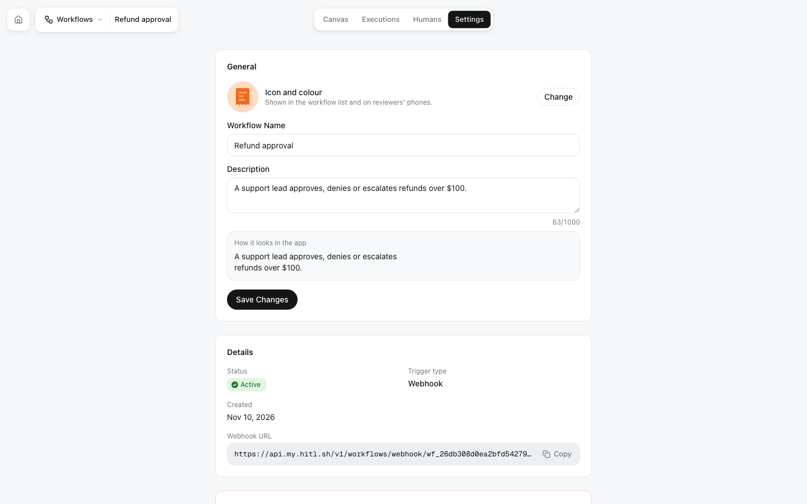

You build workflows in the editor at [my.hitl.sh](https://my.hitl.sh). Open **Workflows** to see yours (and, under **Shared with you**, the ones you review).

<Frame>

</Frame>

## Start a workflow

Click **New workflow**. Describe it in a sentence and HITL drafts the steps, start from an example (refunds, email replies, social posts, change requests, ...), or click **I'll design it myself** for an empty canvas with a Start and an End.

<Frame>

</Frame>

**Import** on the Workflows page loads a workflow from a JSON file.

## The canvas

The top bar has four tabs, **Canvas**, **Executions**, **Humans** and **Settings**, and on the right **Test**, **Activate** (or **Pause** when live) and save.

- Click a step to open its settings on the right.
- Drag from a step's handle to another step to connect them. A condition has a **True** and a **False** handle.
- The toolbar at the bottom: select, pan, **Auto align**, and **+** to add a step. Zoom with the controls on the left or ⌘+ / ⌘−.
- The box next to the toolbar is the workflow assistant: select steps and ask it to change them.

<Frame>

</Frame>

What each step does: [Workflows → Steps](/concepts/workflows#steps).

## The trigger

Click **Start** to choose how runs begin: **Webhook**, **Email**, **Schedule**, **Manual** or **Google Sheets**. A webhook trigger shows its URL and a **Test payload**: sample JSON used by **Test** and by the review step's phone preview. Fields you add there become insertable chips in later steps.

<Frame>

</Frame>

Every workflow can also be run with the API, CLI, MCP, n8n, Zapier and Make, whatever its trigger.

## Review steps

Select a review step, then **Edit request** to write the question and pick the answer type, and **Reviewers** to say who answers and where. The phone preview shows exactly what reviewers will see.

<Frame>

</Frame>

<Frame>

</Frame>

Every setting is explained in [Review steps](/concepts/review-steps).

## Test and activate

- **Test** runs the workflow with the trigger's test payload. Review steps ask people as usual; action steps only log what they would send.
- **Activate** checks the workflow and makes it live. If something is missing, such as a review step without a question, it says what to fix. **Pause** stops new runs.

## Executions

Every run, newest first, with its status (**Waiting for review**, **Completed**, **Failed**, ...). Expand one to see its input, each decision and what each action sent and got back.

<Frame>

</Frame>

## Humans

The workflow's reviewers, its join code, link and QR code, and an invite-by-email form. See [Reviewers](/concepts/reviewers).

## Settings

The icon and colour (shown in lists and on reviewers' phones), name, description, status, trigger type, webhook URL, and **Delete this workflow**.

<Frame>

</Frame>

## Building with an agent

**Connect Claude** in the editor's top bar prints a command (`npx hitl-workflow '<link>'`) that lets Claude Code read and edit the workflow you have open, live: you see its changes on the canvas as it makes them. An agent can also build workflows through the API or MCP (`create_workflow`, `invite_to_workflow`, `activate_workflow`).
