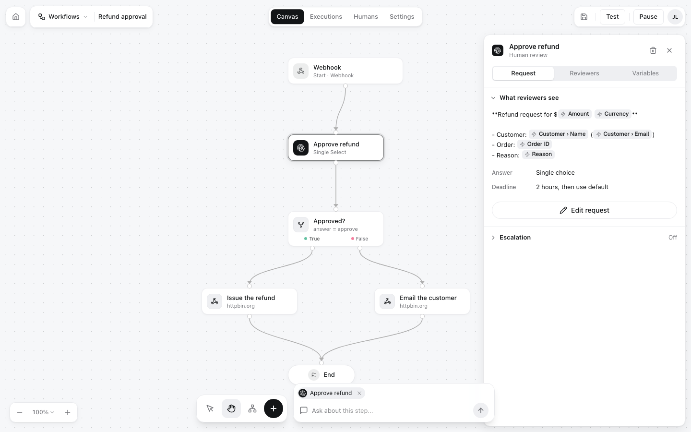

HITL (Human In The Loop) is how software asks a person. You build a **workflow** that says who to ask, what to ask and what to do with the answer. Your agent, your code, n8n, Zapier or Make **runs** it. The people you picked get the question on their phone, in the web inbox or in Telegram, answer it, and the run finishes with their answer.

<Frame>

</Frame>

## How it works

<Steps>
<Step title="Build a workflow">
In the [editor](/guides/workflow-editor) at [my.hitl.sh](https://my.hitl.sh), add a trigger and a **review step**: the question, the kind of answer you want (approve or deny, pick an option, a number, edited text, ...) and a deadline. Add AI, condition and action steps around it if you like.
</Step>
<Step title="Invite the reviewers">
Invite people by email, or share the workflow's join code, QR code or link. They answer in the HITL app for iOS and Android, the web inbox or the Telegram mini app.
</Step>
<Step title="Run it">
Start a run with the [API](/api-reference/runs/run), the [CLI](/integrations/cli), the [MCP server](/integrations/mcp) from Claude, Cursor or another agent, or from [n8n](/integrations/n8n), [Zapier](/integrations/zapier) or [Make](/integrations/make). Each run is an **execution**.
</Step>
<Step title="Get the answer">
The execution moves from `running` to `pending_review` while it waits for a person, then to `completed` with their decision. Read it with `GET /executions/:id?wait=30`, have it POSTed to a `callback_url`, or subscribe to `execution.finished`.
</Step>
</Steps>

## Start here

<CardGroup cols={2}>
<Card title="Quickstart" icon="rocket" href="/quickstart">
From nothing to a person approving your first run, in about five minutes.
</Card>
<Card title="Set up your agent" icon="robot" href="/integrations/agent-setup">
Paste one prompt into Claude Code, Codex or Cursor and let it connect itself.
</Card>
<Card title="Workflows" icon="diagram-project" href="/concepts/workflows">
Triggers, steps, review steps and executions.
</Card>
<Card title="API reference" icon="code" href="/api-reference/introduction">
Run workflows and follow their runs over REST.
</Card>
</CardGroup>

## Ways to connect

<CardGroup cols={3}>
<Card title="MCP" icon="plug" href="/integrations/mcp">Claude, Cursor and any MCP client</Card>
<Card title="CLI" icon="terminal" href="/integrations/cli">`npx @hitl-sh/cli`</Card>
<Card title="REST API" icon="code" href="/integrations/rest">Any language</Card>
<Card title="n8n" icon="diagram-project" href="/integrations/n8n">Community node</Card>
<Card title="Zapier" icon="bolt" href="/integrations/zapier">Run a Workflow action</Card>
<Card title="Make" icon="gears" href="/integrations/make">Verified app</Card>
</CardGroup>

<Note>
Coming from HITL version 1? Read [Moving from HITL version 1](/guides/moving-from-version-1).
</Note>
