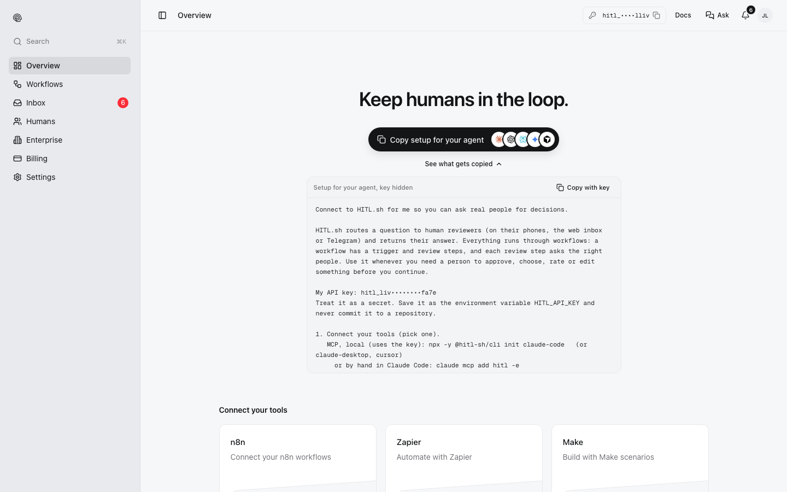

The fastest way to give an agent HITL is to let it set itself up. Copy the setup prompt, paste it into the agent, and answer its questions.

## 1. Copy the prompt

In [my.hitl.sh](https://my.hitl.sh), **Overview → Copy setup for your agent**. The copied prompt includes your API key; on screen it is masked. **See what gets copied** shows the text first.

<Frame>

</Frame>

Without an account, copy it from [hitl.sh](https://hitl.sh) instead: that version has no key and tells the agent how to sign you up.

## 2. Paste it into your agent

The prompt tells the agent to:

1. **Get an API key.** Use yours, or sign you up with your email: `npx -y @hitl-sh/cli signup --email <your email>`, then ask you for the 6-digit code and run `npx -y @hitl-sh/cli signup confirm <code>`. It keeps the key in `HITL_API_KEY`.
2. **Connect a tool**, one of:
   - MCP, local: `npx -y @hitl-sh/cli init claude-code` (or `claude-desktop`, `cursor`), or `claude mcp add hitl -e HITL_API_KEY=$HITL_API_KEY -- npx -y @hitl-sh/mcp`
   - MCP, remote: `claude mcp add --transport http hitl https://mcp.hitl.sh/mcp`, then `/mcp` to sign in
   - CLI: `npx -y @hitl-sh/cli --help`
   - REST: `https://api.hitl.sh/v1/api` with `Authorization: Bearer $HITL_API_KEY`
3. **Work with workflows**: `list_workflows`, `get_workflow_input`, `run_workflow`, then `get_execution` or `watch_execution` until a person answers. To build one: `create_workflow`, `invite_to_workflow` (or `create_workflow_join_code`), `activate_workflow`.
4. **Read** `https://docs.hitl.sh/llms.txt` for the full reference.

It ends by listing your workflows to confirm the connection and, if you have none, offering to build a simple approval workflow with you as the reviewer.

## 3. Use it

Ask in plain words:

```text
Before you run the database migration, ask for approval through my "Deploy gate" workflow
and wait for the answer.
```

```text
Draft replies to the five newest support tickets and run each through "Support reply review".
Send the edited text a person approves.
```

The agent runs the workflow, you get the question on your phone, and the agent continues with your answer. What that looks like in an MCP client: [MCP](/integrations/mcp#run-a-workflow-and-see-the-answer).

<Tip>
Name the workflow in your request, and tell the agent what to do if a person says no. The answer comes back as data (`result`, `decisions`), so the agent can branch on it.
</Tip>
