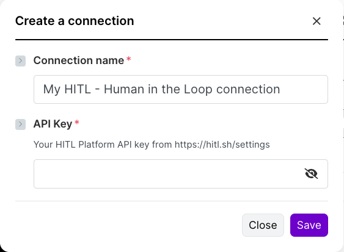
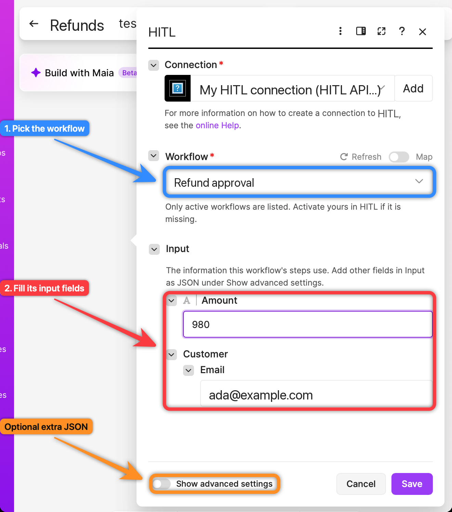
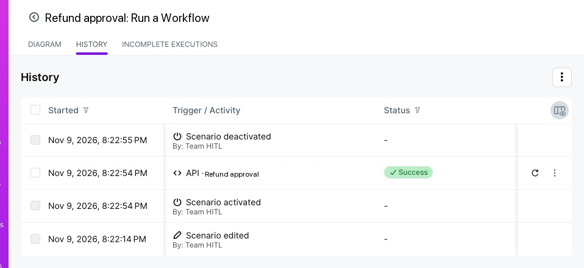
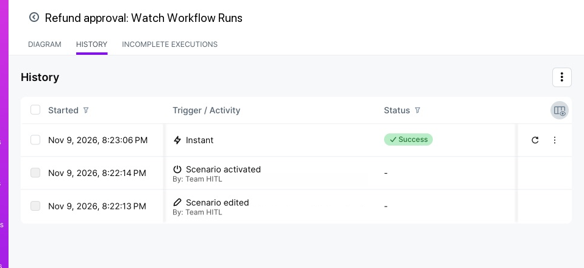

The verified **Human Approval - HITL Platform** app on [Make](https://www.make.com/integrations/hitl) has these modules:

| Module | Type | What it does |
|---|---|---|
| **Run a Workflow** | Action | Starts an active workflow, with a form of its input fields |
| **Watch Workflow Runs** | Instant trigger | Fires when any run of a workflow finishes, with the people's answer |
| **Get a Workflow Run** | Action | One run, optionally waiting up to 30 seconds for it to finish |
| **List Workflow Runs** | Search | A workflow's runs, newest first |
| **List Workflows** | Search | Your workflows |
| **Make an API Call** | Universal | Any other [API](/api-reference/introduction) route |

## How a scenario gets the answer

A Make module can run for at most 40 seconds, and people take longer than that. So use **two scenarios**:

1. **Start**: your trigger, then **Run a Workflow**.
2. **Carry on**: **Watch Workflow Runs** on the same workflow, then whatever should happen with the answer.

## Set up

<Steps>
<Step title="Create a connection">
Add any HITL module, click **Add** next to **Connection**, and paste your [API key](/api-keys).

<Frame>

</Frame>
</Step>
</Steps>

## Scenario 1: run the workflow

<Steps>
<Step title="Add Run a Workflow">
Pick the **Workflow** (only active workflows are listed), then fill in its **Input**: Make builds the form from the fields the workflow reads, so `customer.email` shows as **Email** inside a **Customer** group. Map values from earlier modules.

<Frame>

</Frame>

Fields are sent as text. To send numbers, or data the steps do not read directly, use **Input as JSON** under **Show advanced settings**.
</Step>
<Step title="Run it">
The module returns the new run (`status: running`) straight away, and the reviewers get the question.

<Frame>

</Frame>
</Step>
</Steps>

## Scenario 2: carry on with the answer

<Steps>
<Step title="Add Watch Workflow Runs">
Start a new scenario with **Watch Workflow Runs** and pick the same workflow. It subscribes itself to the workflow's finished runs, so there is no URL to copy. Turn the scenario **on** and keep it on.
</Step>
<Step title="A person answers">
When a reviewer answers and the run finishes, the scenario runs with **Answer**, **Decided By**, **Status** and the rest of the run. Add a router or filter on **Answer** to do different things for *approve* and *deny*.

<Frame>

</Frame>
</Step>
</Steps>

<Note>
Deleting the scenario's webhook in Make also removes the HITL subscription. Runs finishing while the Watch scenario is off are not delivered later; read them with **List Workflow Runs**.
</Note>
