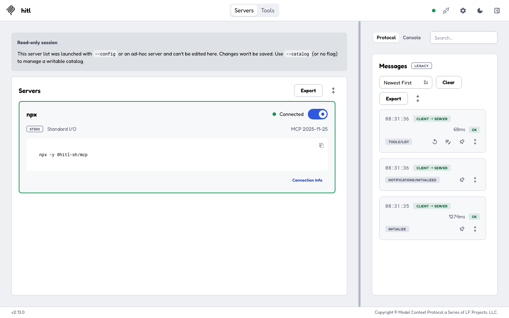
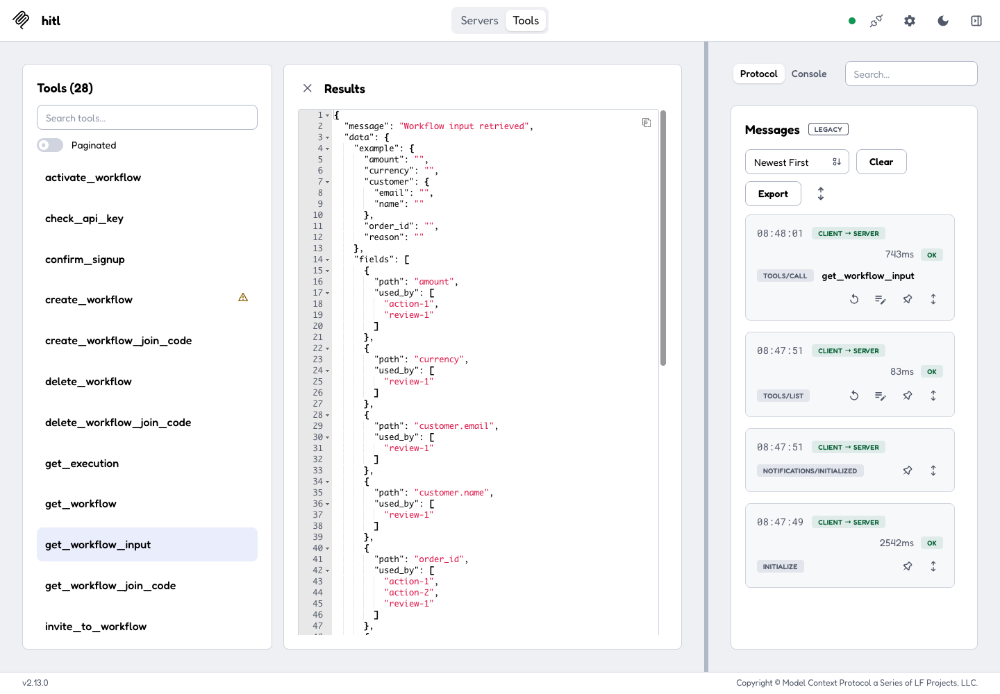
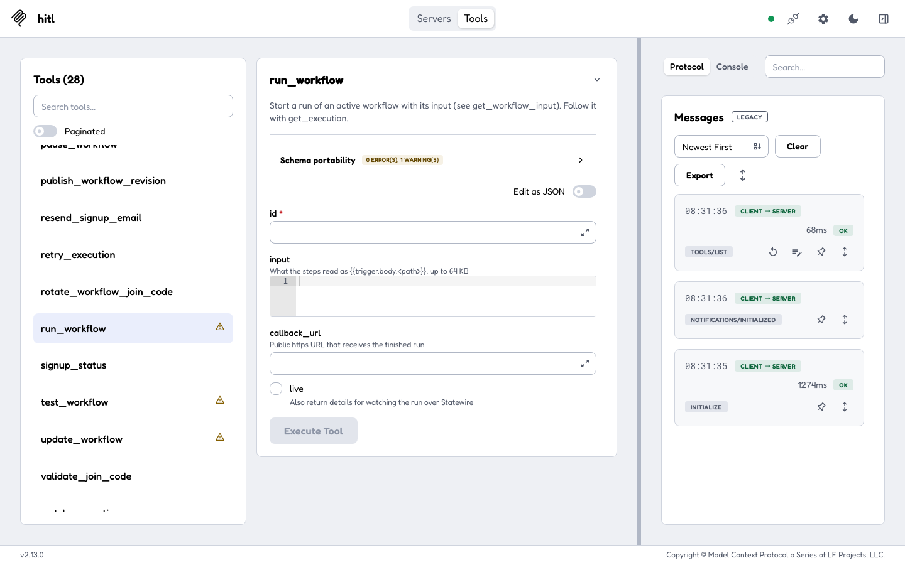
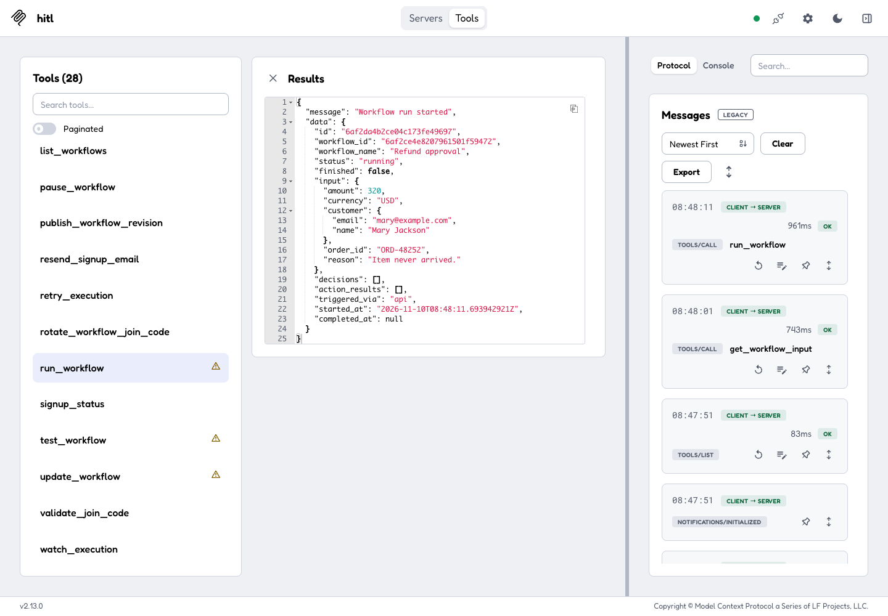
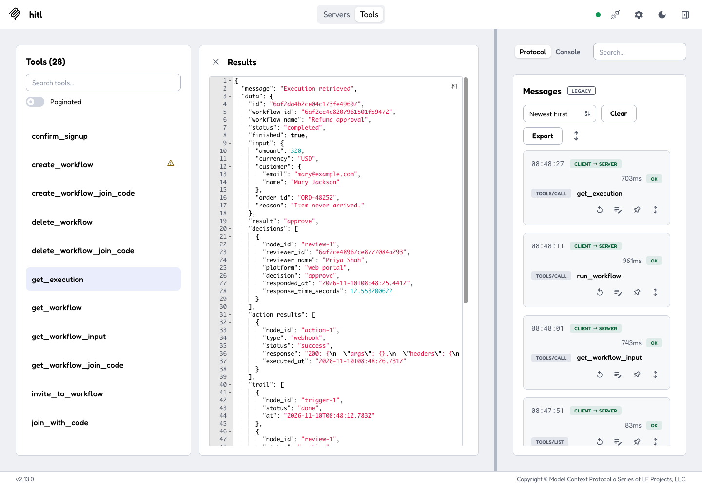

The HITL MCP server lets an AI assistant run your workflows and wait for a person's answer, and build workflows for you. It runs locally (`@hitl-sh/mcp`, with your API key) or remotely at `https://mcp.hitl.sh/mcp` (sign in through the browser).

## Set up

<Tabs>
<Tab title="Claude Code">
```bash
npx -y @hitl-sh/cli init claude-code
```

This runs `claude mcp add hitl -e HITL_API_KEY=… -- npx -y @hitl-sh/mcp` with the key from `HITL_API_KEY` (or the one saved by `hitl login`). By hand:

```bash
claude mcp add hitl -e HITL_API_KEY=$HITL_API_KEY -- npx -y @hitl-sh/mcp
```

Remote, signing in through the browser instead of a key:

```bash
claude mcp add --transport http hitl https://mcp.hitl.sh/mcp
```

then run `/mcp` in Claude Code and sign in.
</Tab>
<Tab title="Claude Desktop">
```bash
npx -y @hitl-sh/cli init claude-desktop
```

It adds the server to `claude_desktop_config.json` (keeping a `.bak`). Restart Claude Desktop. By hand:

```json claude_desktop_config.json
{
  "mcpServers": {
    "hitl": {
      "command": "npx",
      "args": ["-y", "@hitl-sh/mcp"],
      "env": { "HITL_API_KEY": "hitl_live_..." }
    }
  }
}
```
</Tab>
<Tab title="Cursor">
```bash
npx -y @hitl-sh/cli init cursor
```

It adds the same `hitl` entry to `~/.cursor/mcp.json` (keeping a `.bak`).
</Tab>
<Tab title="Other clients">
`npx -y @hitl-sh/cli init` prints the JSON for any client that takes a command. Clients that take a URL (ChatGPT connectors, OpenAI Agent Builder, ...) use `https://mcp.hitl.sh/mcp` with OAuth sign-in.
</Tab>
</Tabs>

<Frame caption="The MCP Inspector connected to npx -y @hitl-sh/mcp">

</Frame>

## Run a workflow and see the answer

This walk-through uses the [MCP Inspector](https://github.com/modelcontextprotocol/inspector) so you can see each call; in Claude or Cursor the assistant makes the same calls when you ask it to.

<Steps>
<Step title="Find the workflow and its input">
`list_workflows` lists your workflows. `get_workflow_input` returns the fields the workflow's steps read, with an example body.

<Frame>

</Frame>
</Step>
<Step title="Run it">
`run_workflow` takes the workflow `id`, the `input`, and optionally a `callback_url` and `live`.

<Frame>

</Frame>

It answers at once with the execution, `status: running`:

<Frame>

</Frame>
</Step>
<Step title="A person answers">
The reviewers get the question on their phone, in the web inbox or in Telegram, and answer.
</Step>
<Step title="Get the answer">
`get_execution` with the execution id and `wait` (up to 60 seconds) returns as soon as the run has finished: `status: completed`, `result: "approve"`, and in `decisions` who answered (Priya Shah) and where (`web_portal`).

<Frame>

</Frame>
</Step>
</Steps>

In a chat, all of that is one request: *"Run Refund approval for Mary Jackson's $320 order ORD-48252 and tell me what the reviewer decided."*

## Tools

| Group | Tools |
|---|---|
| Account | `check_api_key`, `signup_status`, `confirm_signup`, `resend_signup_email` |
| Find and run | `list_workflows`, `get_workflow`, `get_workflow_input`, `run_workflow`, `get_execution`, `list_workflow_executions`, `watch_execution`, `retry_execution` |
| Build and manage | `create_workflow`, `update_workflow`, `delete_workflow`, `activate_workflow`, `pause_workflow`, `test_workflow`, `list_workflow_revisions`, `publish_workflow_revision` |
| Reviewers | `list_workflow_humans`, `invite_to_workflow`, `get_workflow_join_code`, `create_workflow_join_code`, `delete_workflow_join_code`, `rotate_workflow_join_code`, `validate_join_code`, `join_with_code` |

Each tool maps to one [API endpoint](/api-reference/introduction) and takes the same fields. Signing up (getting a key) is in the [CLI](/integrations/cli#sign-up-without-a-browser), since the server needs a key to start.

## Configuration

| Variable | |
|---|---|
| `HITL_API_KEY` | Your API key (required for the local server) |
| `HITL_API_BASE` | Default `https://api.hitl.sh/v1` |

The key is only sent to `hitl.sh` hosts.
