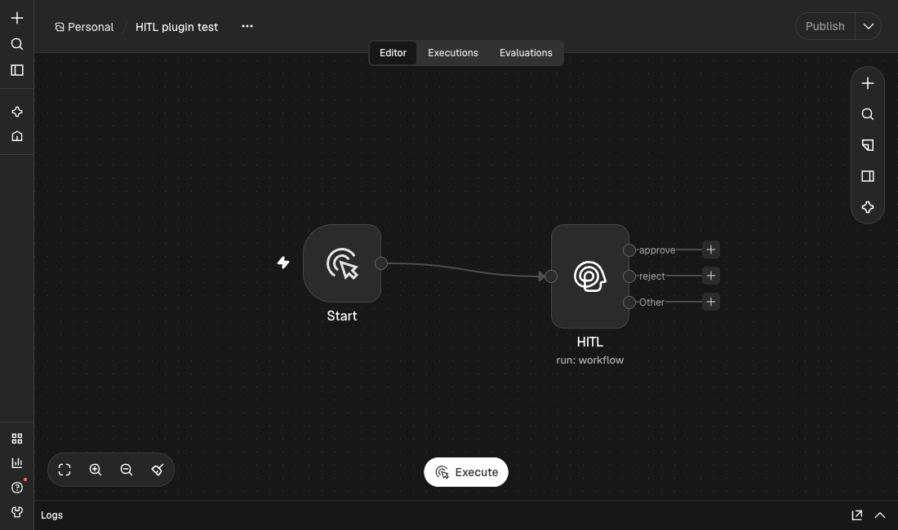
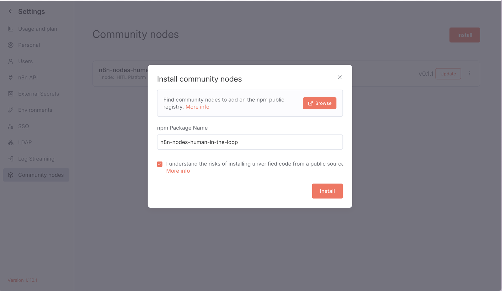
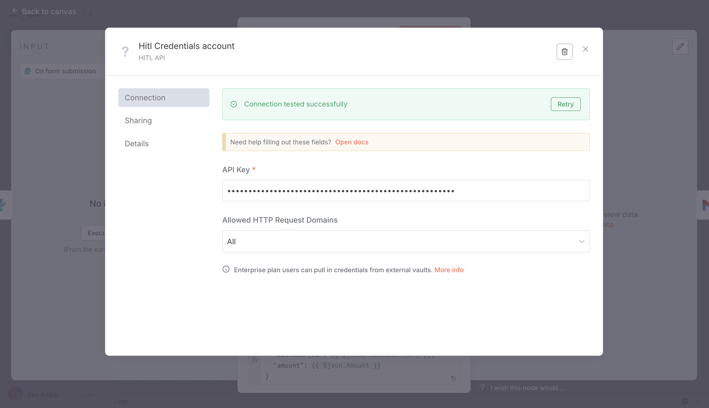
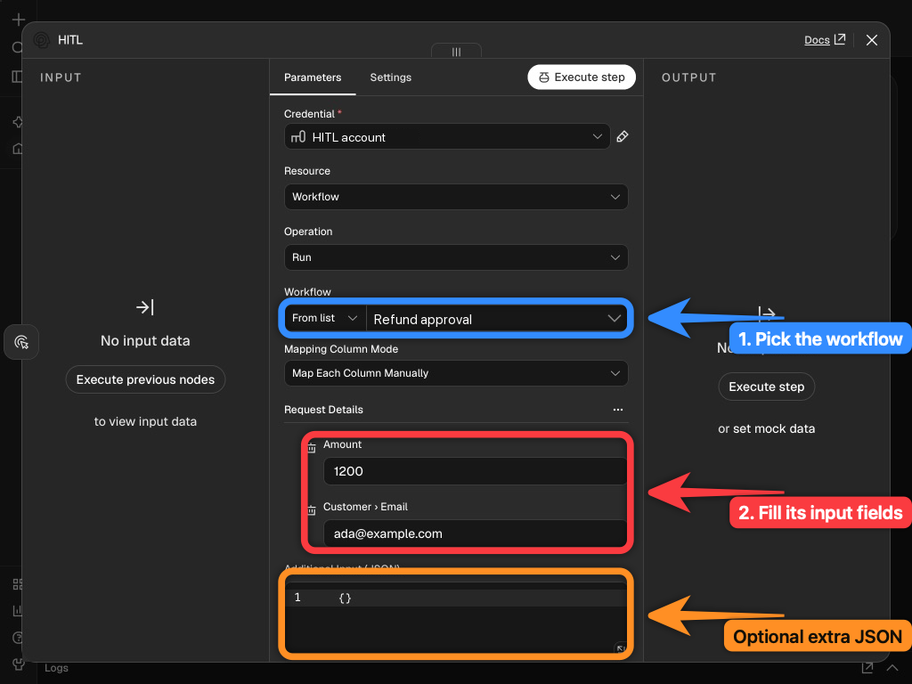
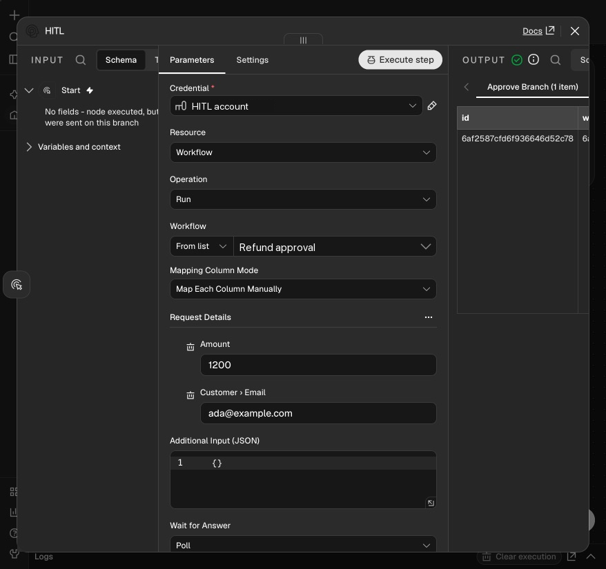
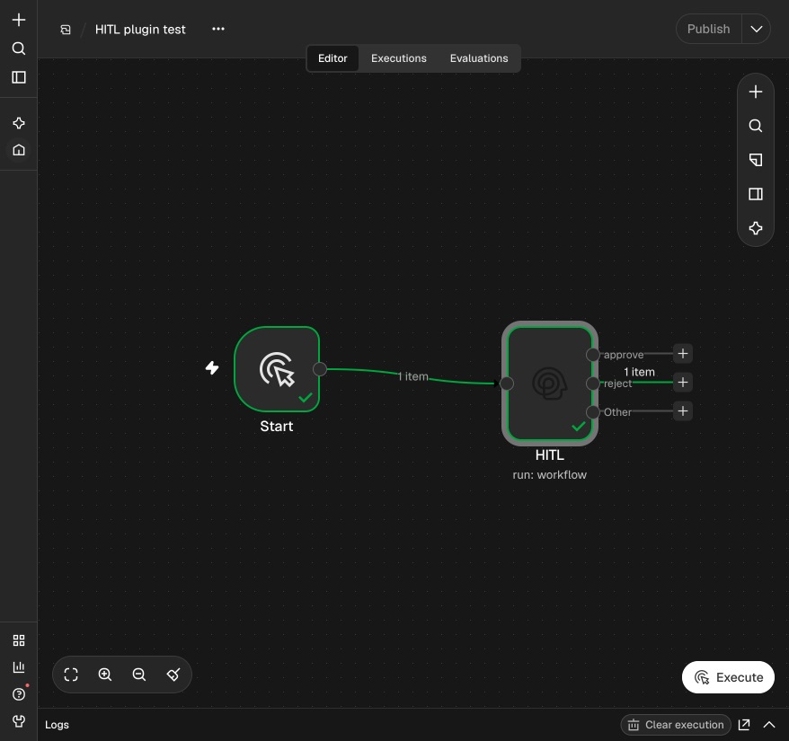
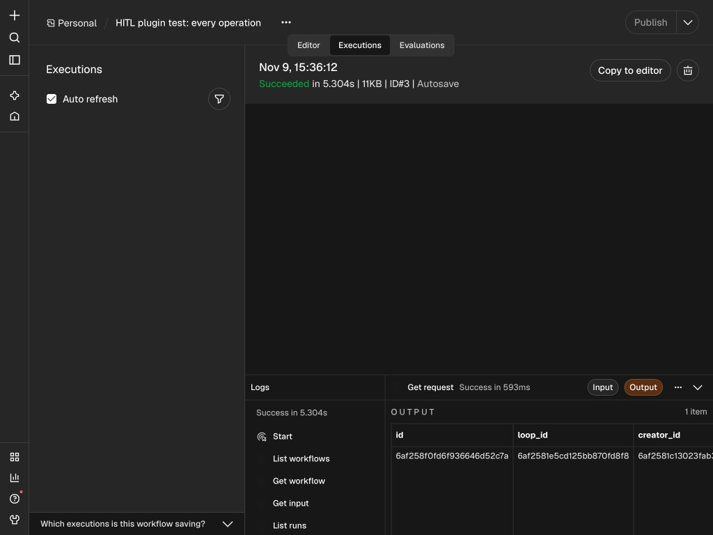
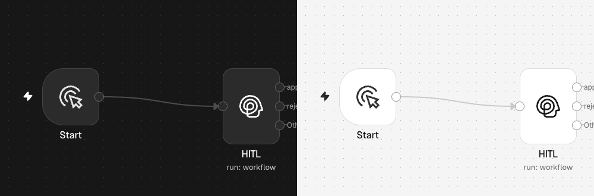

The **HITL** community node (`n8n-nodes-human-in-the-loop`) runs one of your HITL workflows with data from n8n, waits for the person's answer, and continues on a different output for each answer.

<Frame>

</Frame>

## Set up

<Steps>
<Step title="Install the node">
In n8n, open **Settings → Community nodes → Install**, enter `n8n-nodes-human-in-the-loop` and install it.

<Frame>

</Frame>
</Step>
<Step title="Add your API key">
Create a **HITL.sh Human Approval API** credential and paste your [API key](/api-keys). The key is only sent to `api.hitl.sh`.

<Frame>

</Frame>
</Step>
<Step title="Have an active workflow in HITL">
Build a workflow with a review step in [my.hitl.sh](https://my.hitl.sh) and activate it. Its fields (`{{trigger.body.amount}}`, ...) become the node's inputs.
</Step>
</Steps>

## Run a workflow and branch on the answer

<Steps>
<Step title="Add the HITL node">
Add **HITL** after your trigger. Set **Resource** to *Workflow*, **Operation** to *Run*, and pick the **Workflow** from the list.
</Step>
<Step title="Fill in its input">
The node loads the fields the workflow reads. Map each one from earlier nodes, for example **Amount** to `{{ $json.amount }}`. **Additional Input (JSON)** adds anything else.

<Frame>

</Frame>
</Step>
<Step title="Choose how to wait, and the outputs">
**Wait for Answer**:

| Option | What happens |
|---|---|
| **Automatic** | A callback when HITL can reach your n8n, otherwise polling |
| **Callback** | The n8n execution pauses and frees the worker until HITL calls back. Needs a public `https` n8n address (`WEBHOOK_URL`) |
| **Poll** | The execution keeps running and checks for the answer. Works on any n8n |
| **Don't Wait** | Continues at once with the run id. Read the answer later with *Run → Get* |

**Stop Waiting After (Hours)** caps the wait. **Answer Output Names or IDs**: pick answers (such as *approve* and *reject*) to give each its own output; other answers, no answer in time and failed runs go to **Other**.
</Step>
<Step title="Execute and answer">
Run the n8n workflow. The reviewers get the question; when one answers, the node continues on that answer's output.

<Frame caption="Approved: the item leaves on the approve output">

</Frame>

<Frame caption="Rejected: the canvas shows the item routed to reject">

</Frame>
</Step>
</Steps>

The output item is the execution: `status` (`completed`, `failed`, `timed_out`), `result` (the last answer), `decisions` (who answered what, where) and the rest of the [execution](/concepts/executions). When polling stops at **Stop Waiting After**, the item has the run so far and `stopped_waiting: true`.

## Operations

| Resource | Operation | What it does |
|---|---|---|
| Workflow | **Run** | Start a workflow, optionally wait for the answer |
| Workflow | **Get Many**, **Get** | Your workflows and their steps |
| Workflow | **Get Input Fields** | The fields a workflow's steps read |
| Run | **Get**, **Get Many** | One run, or a workflow's runs |

<Frame>

</Frame>

The node also works as a tool for n8n's **AI Agent**, where it polls for the answer.

## Notes

- A callback only wakes the n8n execution; the node then reads the answer from the HITL API with your key, so the resume URL cannot be used to fake a decision.
- A paused execution continues with its input data: check for a `status` field in the next step.
- Saved n8n workflows that use version 1 of the node keep working unchanged.

<Frame caption="The node's icon in n8n's dark and light themes">

</Frame>
