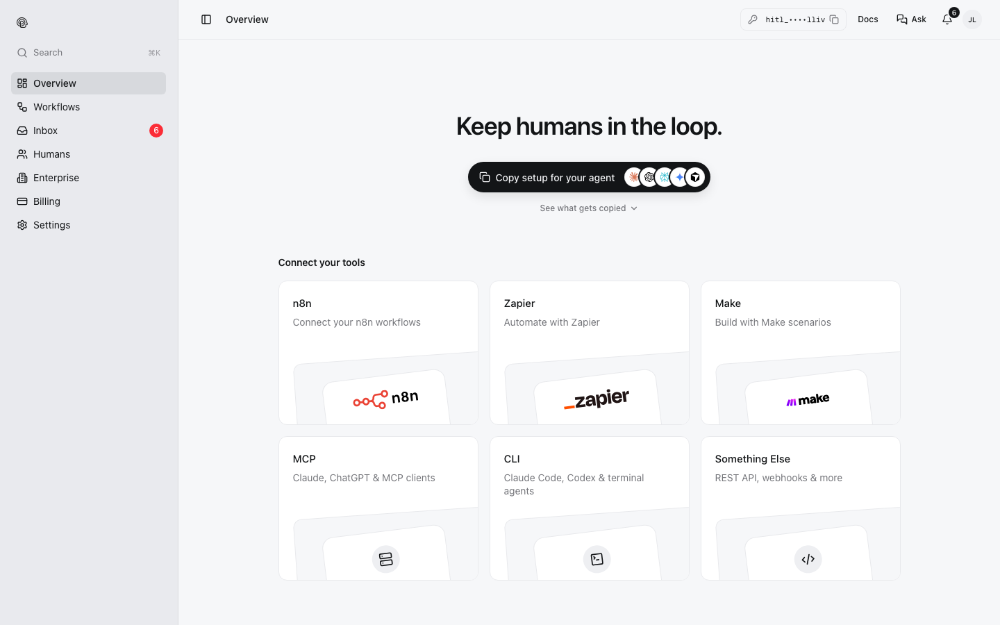

All integrations do the same three things: find a workflow, run it with some input, and return when a person has answered. They differ in where you use them.

| Integration | Best for | Gets the answer by |
|---|---|---|
| [Agent setup prompt](/integrations/agent-setup) | Connecting any coding agent in one paste | MCP or CLI, below |
| [MCP server](/integrations/mcp) | Claude Desktop, Claude Code, Cursor, ChatGPT and other MCP clients | `get_execution` with `wait`, or `watch_execution` |
| [CLI](/integrations/cli) | Terminals, scripts, CI, agents with a shell | `hitl run --wait` / `--watch` |
| [REST API](/integrations/rest) | Your own code, any language | `GET /executions/:id?wait=`, `callback_url`, webhooks |
| [n8n](/integrations/n8n) | n8n workflows | Pauses the n8n execution until the answer, then branches on it |
| [Zapier](/integrations/zapier) | Zaps | Pauses the Zap until the answer |
| [Make](/integrations/make) | Make scenarios | A second scenario starts with **Watch Workflow Runs** |

Every integration needs an [API key](/api-keys) (the remote MCP server can sign in through the browser instead) and an **active** workflow with at least one review step.

## Connect from my.hitl.sh

**Overview** in my.hitl.sh has a **Connect your tools** section with a setup guide for each.

<Frame>

</Frame>

## Packages

| Package | What |
|---|---|
| [`@hitl-sh/cli`](https://www.npmjs.com/package/@hitl-sh/cli) | The `hitl` command, including `hitl mcp` and `hitl init` |
| [`@hitl-sh/mcp`](https://www.npmjs.com/package/@hitl-sh/mcp) | The MCP server on its own: `npx -y @hitl-sh/mcp` |
| [`@hitl-sh/core`](https://www.npmjs.com/package/@hitl-sh/core) | A typed TypeScript client for the API and the MCP tool definitions |
| [`n8n-nodes-human-in-the-loop`](https://www.npmjs.com/package/n8n-nodes-human-in-the-loop) | The n8n community node |

Source: [github.com/hitl-sh/cli](https://github.com/hitl-sh/cli). For other languages, call the [REST API](/integrations/rest) directly.
