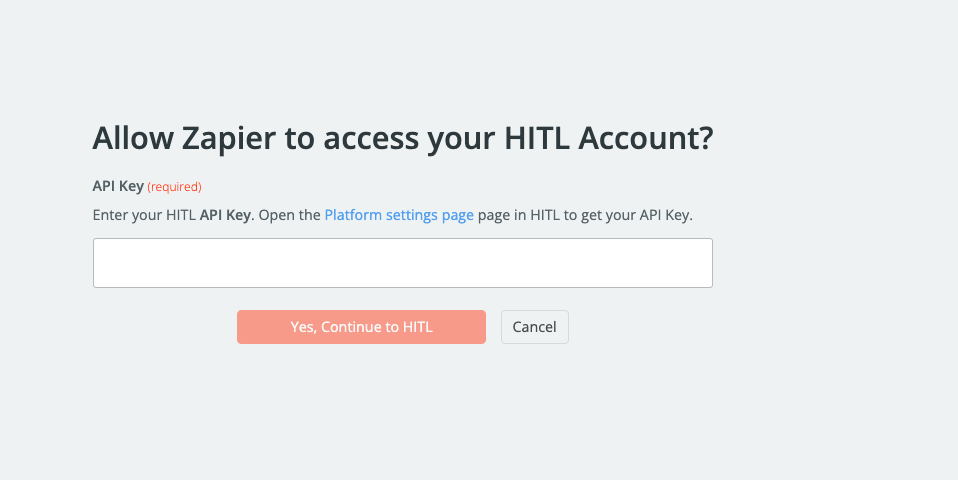
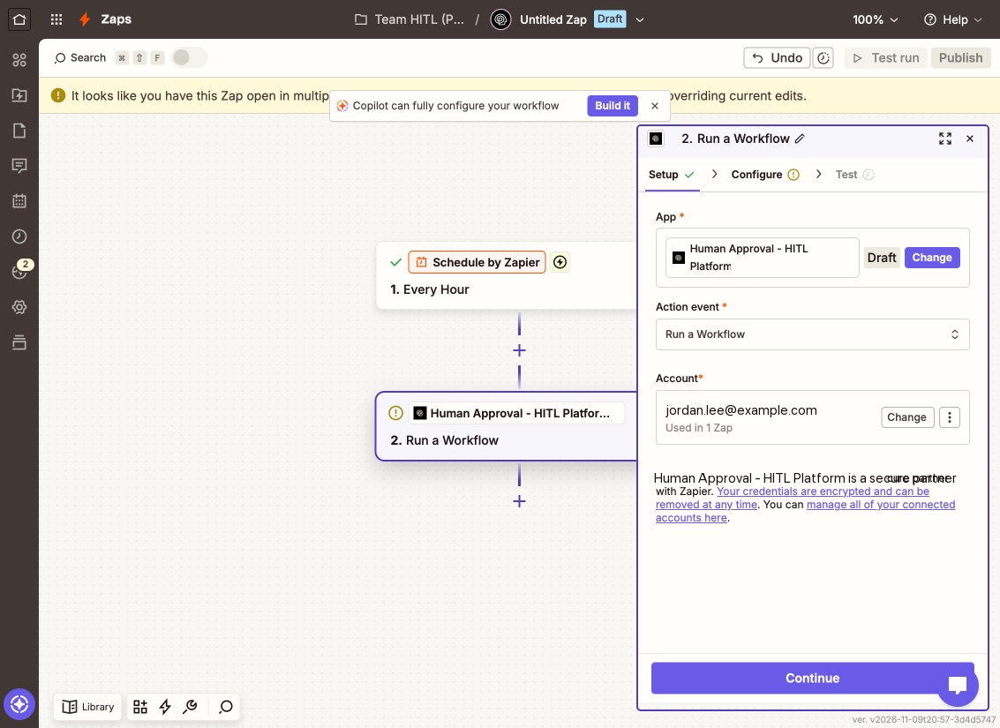
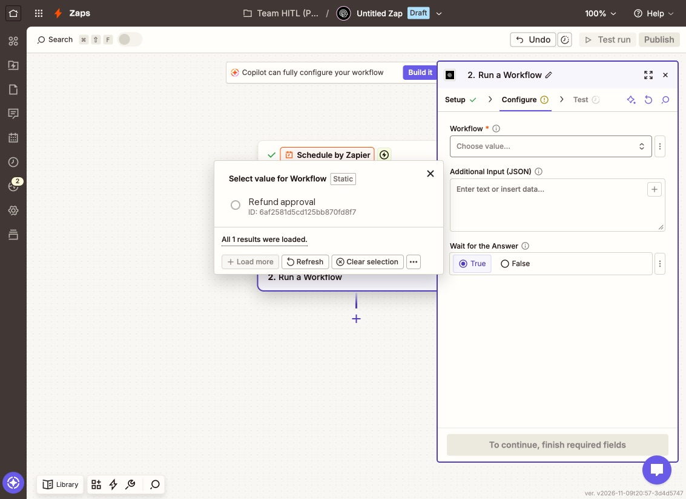
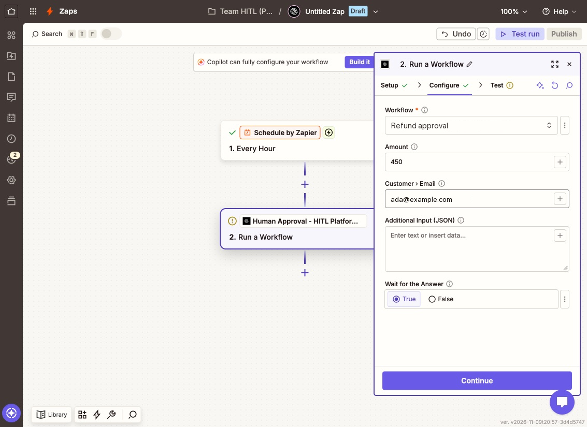
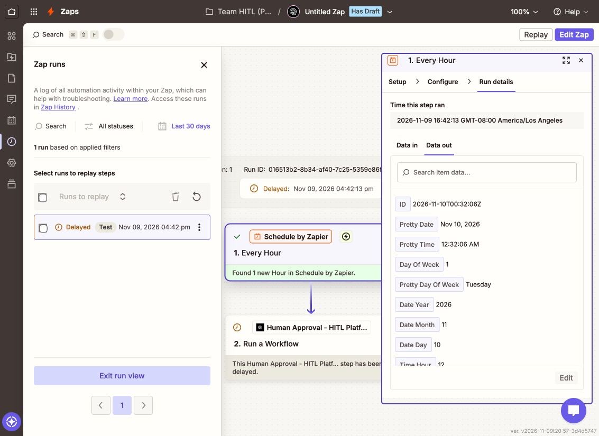
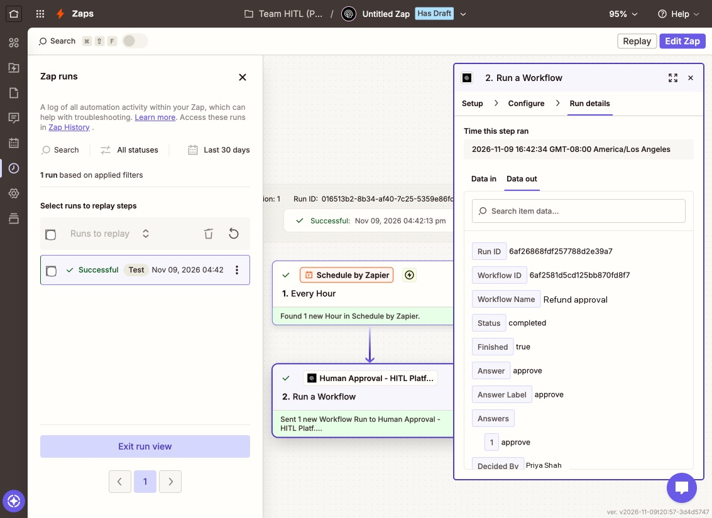

The **Human Approval - HITL Platform** app on Zapier has two workflow steps:

| Step | Type | What it does |
|---|---|---|
| **Run a Workflow** | Action | Runs an active HITL workflow with fields from your Zap, and pauses the Zap until a person answers |
| **Find a Workflow Run** | Search | Looks up a run and its answer by run id |

## Set up

<Steps>
<Step title="Add the action">
In the Zap editor, add a step, search for **Human Approval - HITL Platform**, and choose the **Run a Workflow** action event.
</Step>
<Step title="Connect your account">
Under **Account**, connect HITL with your [API key](/api-keys).

<Frame>

</Frame>

<Frame>

</Frame>
</Step>
</Steps>

## Run a workflow and use the answer

<Steps>
<Step title="Pick the workflow">
**Workflow** lists your active workflows.

<Frame>

</Frame>
</Step>
<Step title="Map its fields">
Zapier loads the fields the workflow's steps read (here **Amount** and **Customer › Email**). Map them from earlier steps. **Additional Input (JSON)** adds anything else; mapped fields win. Leave **Wait for the Answer** on *True*.

<Frame>

</Frame>
</Step>
<Step title="The Zap waits for the person">
When the Zap runs, HITL starts the workflow and Zapier holds the run as **Delayed** until a reviewer answers on their phone, in the web inbox or in Telegram.

<Frame>

</Frame>
</Step>
<Step title="It continues with the answer">
When the person answers, HITL calls Zapier back, the step reads the run again from the API and the Zap carries on. Its output includes **Answer** (`approve`), **Answer Label**, **Decided By** (`Priya Shah`), **Status** (`completed`), the run id and the whole run.

<Frame>

</Frame>
</Step>
<Step title="Branch on it">
Add **Paths by Zapier** after the step, with rules on **Answer**: for example *Answer exactly matches approve* → issue the refund; otherwise → notify the customer.
</Step>
</Steps>

**Answer** is the option value for a choice, `true`/`false` for Approve / Deny, a number, or text.

## Without waiting

Set **Wait for the Answer** to *False* and the Zap continues at once with the run id. Read the answer later with **Find a Workflow Run**.
