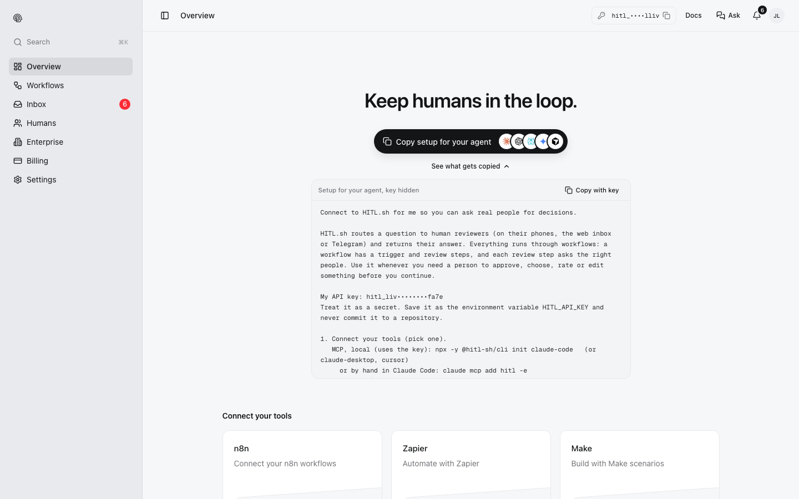
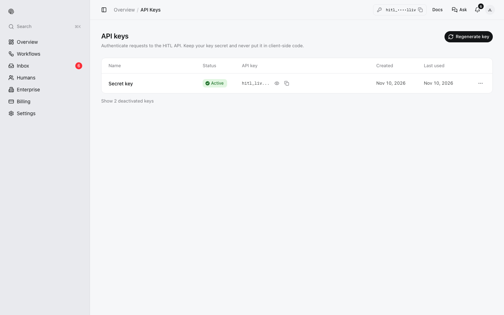
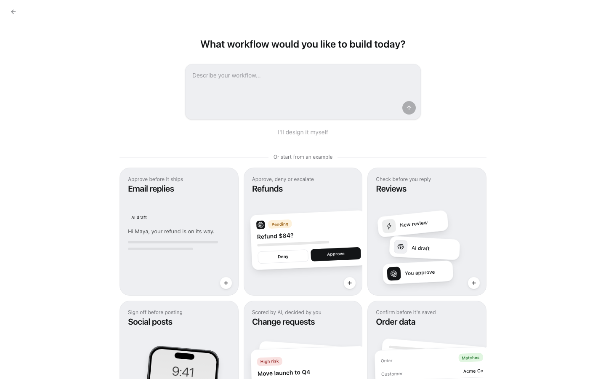
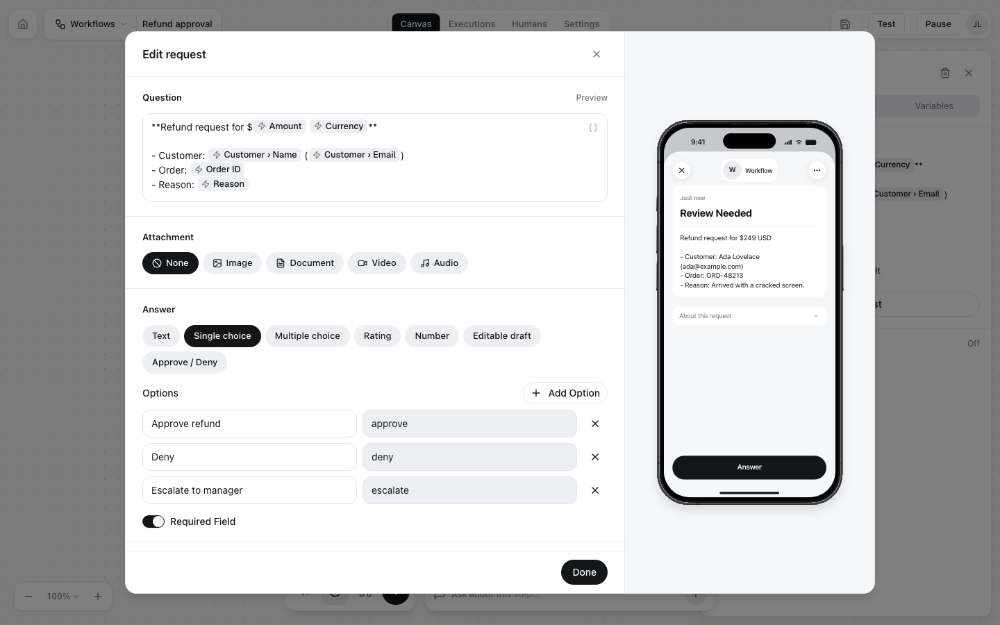
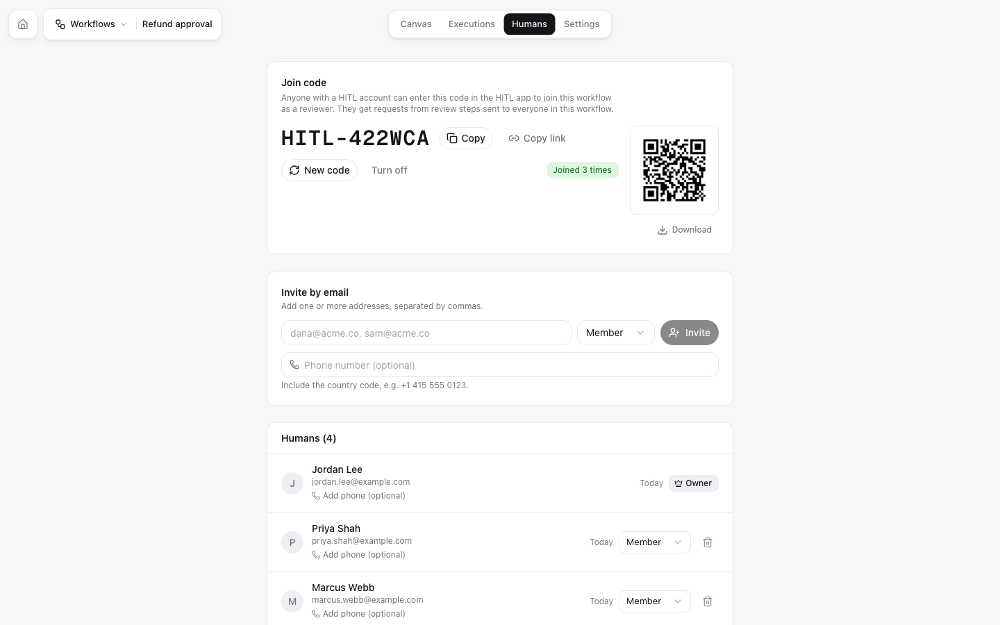
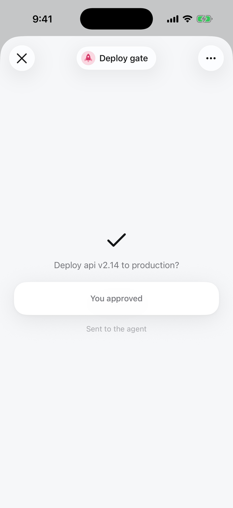
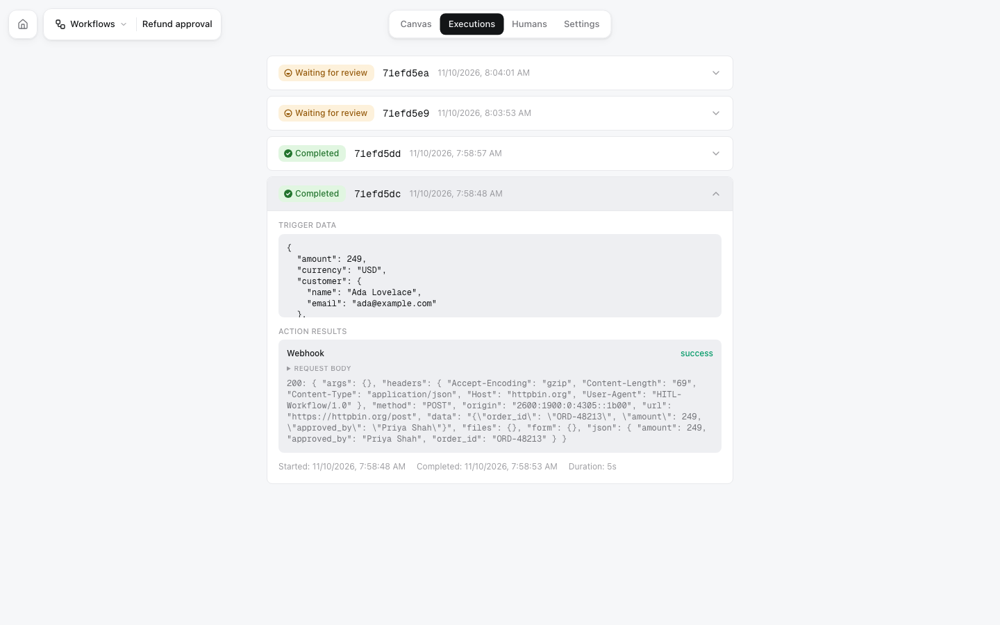

There are two ways in. If you work with a coding agent (Claude Code, Codex, Cursor, ...), let it set itself up. Otherwise, follow the manual path: it takes about five minutes.

<Tabs>
<Tab title="Let your agent do it">

<Steps>
<Step title="Copy the setup prompt">
Sign in at [my.hitl.sh](https://my.hitl.sh). On **Overview**, click **Copy setup for your agent**. **See what gets copied** shows the prompt first; your API key is included, hidden on screen.

<Frame>

</Frame>

No account yet? The same prompt is on [hitl.sh](https://hitl.sh) without a key: the agent signs you up with your email and asks you for the 6-digit code HITL emails you.
</Step>
<Step title="Paste it into your agent">
The agent connects the HITL MCP server (or the CLI), lists your workflows to check the connection, and offers to build a simple approval workflow with you as the reviewer if you have none.
</Step>
<Step title="Install the app and answer">
Install HITL on your phone ([iOS and Android](https://hitl.sh/download)) and sign in with the same email. When the agent runs the workflow, the question arrives as a notification. Answer it, and the agent reads your answer from the run.
</Step>
</Steps>

What the prompt says and how to adjust it: [Agent setup prompt](/integrations/agent-setup).

</Tab>
<Tab title="Do it yourself">

<Steps>
<Step title="Create an account and an API key">
Sign in at [my.hitl.sh](https://my.hitl.sh) with Google, Apple or your email. Open **API keys** and copy your key (`hitl_live_…`). Keep it in an environment variable:

```bash
export HITL_API_KEY=hitl_live_...
```

<Frame>

</Frame>

An agent can also get a key without a browser: `npx -y @hitl-sh/cli signup --email you@example.com`, then `npx -y @hitl-sh/cli signup confirm <code>` with the code from the email. See [API keys](/api-keys).
</Step>

<Step title="Build a workflow">
Open **Workflows** and click **New workflow**. Describe what you want ("approve refunds over $100") or pick an example, or click **I'll design it myself**.

<Frame>

</Frame>

Every workflow starts with a **trigger** and ends with **End**. Add a **Human Review** step between them, and in it:

- **Question**: what reviewers read. Insert fields from the run's input, such as `{{trigger.body.amount}}`.
- **Answer**: for example **Single choice** with *Approve refund* / *Deny*, or **Approve / Deny**.
- **Deadline**: how long people have, and what happens after.

<Frame>

</Frame>

The [workflow editor guide](/guides/workflow-editor) covers every step type.
</Step>

<Step title="Add yourself (and others) as reviewers">
Open the workflow's **Humans** tab. You are already on it as the owner. Invite others by email, or share the join code, link or QR code.

<Frame>

</Frame>
</Step>

<Step title="Activate it">
Click **Activate** in the editor's top bar. HITL checks the workflow first and tells you what to fix if something is missing. Only active workflows can run.
</Step>

<Step title="Install the app">
Install HITL on your phone ([iOS and Android](https://hitl.sh/download)) and sign in with the same account. You can also answer in the [web inbox](/answering/web-inbox) or [Telegram](/answering/telegram).
</Step>

<Step title="Run it">
Find the workflow's id and the input fields it reads, then start a run.

<CodeGroup>
```bash CLI
npx -y @hitl-sh/cli workflows list
npx -y @hitl-sh/cli workflows input <workflow-id>
npx -y @hitl-sh/cli run <workflow-id> \
  --input '{"order_id":"ORD-48252","customer":{"name":"Mary Jackson","email":"mary@example.com"},"amount":320,"currency":"USD","reason":"Item never arrived."}' \
  --wait 600
```

```bash curl
curl -X POST https://api.hitl.sh/v1/api/workflows/<workflow-id>/run \
  -H "Authorization: Bearer $HITL_API_KEY" \
  -H "Content-Type: application/json" \
  -d '{"input": {"order_id": "ORD-48252", "customer": {"name": "Mary Jackson", "email": "mary@example.com"}, "amount": 320, "currency": "USD", "reason": "Item never arrived."}}'
```

```text MCP (ask your agent)
Run my "Refund approval" workflow for order ORD-48252: Mary Jackson, mary@example.com,
$320 USD, "Item never arrived." Wait for the answer and tell me what was decided.
```
</CodeGroup>

The API answers `202` with the new execution (`"status": "running"`).
</Step>

<Step title="Answer on your phone">
A notification arrives. Open it, read the question, pick an answer and submit.

<Columns cols={2}>
<Frame>

</Frame>
<Frame>

</Frame>
</Columns>
</Step>

<Step title="Get the result">
With `--wait` the CLI prints the result as soon as you answer. Over REST, read the execution; `wait` holds the call until the run finishes (up to 60 seconds):

```bash
curl "https://api.hitl.sh/v1/api/executions/<execution-id>?wait=30" \
  -H "Authorization: Bearer $HITL_API_KEY"
```

```json
{
  "error": false,
  "msg": "Execution retrieved",
  "data": {
    "id": "6af2da4b2ce04c173fe49697",
    "workflow_name": "Refund approval",
    "status": "completed",
    "finished": true,
    "result": "approve",
    "decisions": [
      {
        "node_id": "review-1",
        "reviewer_name": "Priya Shah",
        "platform": "web_portal",
        "decision": "approve",
        "responded_at": "2026-11-10T08:48:25.441Z",
        "response_time_seconds": 12.55
      }
    ]
  }
}
```

The run also shows in the workflow's **Executions** tab, with its input, each decision and what the action steps sent.

<Frame>

</Frame>
</Step>
</Steps>

</Tab>
</Tabs>

## Next steps

<CardGroup cols={2}>
<Card title="Executions and results" icon="list-check" href="/concepts/executions">
Statuses, `wait`, callbacks and webhooks.
</Card>
<Card title="Workflow editor" icon="pen-ruler" href="/guides/workflow-editor">
Conditions, AI steps and actions around the review.
</Card>
<Card title="Answer types" icon="shapes" href="/responses/types">
Choices, ratings, numbers, edited drafts and more.
</Card>
<Card title="Integrations" icon="plug" href="/integrations/overview">
MCP, CLI, n8n, Zapier, Make and REST.
</Card>
</CardGroup>
