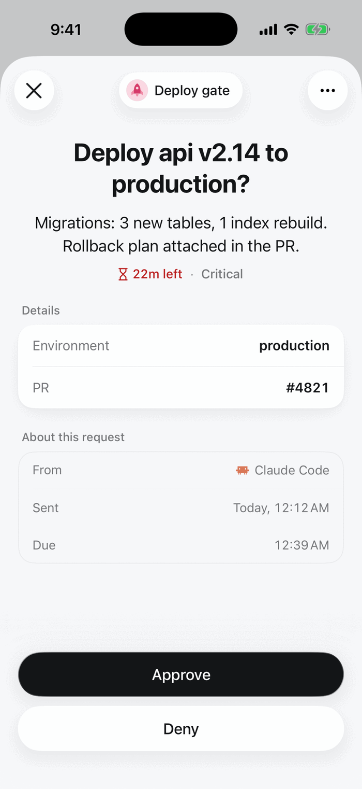

Two buttons. The run gets `true` or `false`.

<Frame>

</Frame>

## Set it up

In the review step, click **Edit request** and choose **Approve / Deny** under **Answer**. Rename the buttons if *Approve* and *Deny* don't fit, for example *Ship it* / *Hold*.

Over the API or MCP, set the review step's `responseType` to `boolean` and these fields in `responseConfig`:

| Field | |
|---|---|
| `true_label` | Text of the yes button. Default *Approve* |
| `false_label` | Text of the no button. Default *Deny* |
| `required` | The reviewer must answer to submit |

```json
{
  "type": "review",
  "data": {
    "requestText": "...",
    "responseType": "boolean",
    "responseConfig": {"true_label": "Approve", "false_label": "Deny", "required": true}
  }
}
```

## What the run gets

The answer is the decision of the step, and `result` if it is the last review:

```json
{"decision": true, "reviewer_name": "Priya Shah", "platform": "mobile"}
```

A condition `response.value equals true` continues only when approved.

[All answer types](/responses/types)
