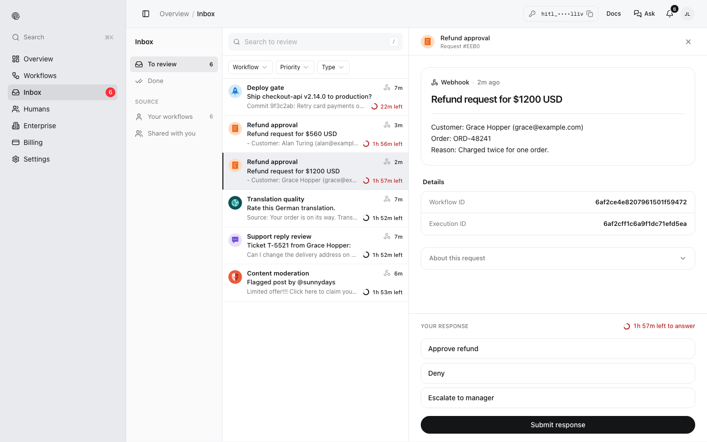

The question a review step sends is **Markdown**, filled in with the run's data when the step is reached. Reviewers see it rendered in the app, the web inbox and Telegram.

## Markdown

Headings, **bold**, *italics*, lists, links, tables and code all work. The refund workflow's question:

```markdown
**Refund request**

| | |
|---|---|
| Customer | {{trigger.body.customer.name}} ({{trigger.body.customer.email}}) |
| Order | {{trigger.body.order_id}} |
| Amount | ${{trigger.body.amount}} {{trigger.body.currency}} |

**Reason:** {{trigger.body.reason}}
```

and what Priya sees in the web inbox:

<Frame>

</Frame>

## Inserting data

| Write | To show |
|---|---|
| `{{trigger.body.<path>}}` | A field of the run's input, such as `{{trigger.body.customer.email}}` |
| `{{ai.result}}` | The output of an earlier AI step |
| `{{response.value}}`, `{{response.by.name}}` | An earlier review step's answer and who gave it |

In the editor, insert fields as chips from the trigger's test payload; the phone preview shows the result. A field that is missing from the input is left empty.

## Files

To show a reviewer a file (a screenshot, a contract, a recording), put its URL in the input and link it in the question: `[Open the contract]({{trigger.body.contract_url}})`. You can host the file anywhere public, or upload it with [`POST /upload/image`](/api-reference/uploads/image) (JPEG, PNG, GIF or WebP, up to 10 MB) or [`POST /upload/document`](/api-reference/uploads/document) (PDF, Word, Excel, PowerPoint, CSV or text, up to 50 MB), which return its URL.

<Note>
The editor's **Attachment** setting (Image, Document, Video, Audio) shows the file in the step's phone preview. Runs currently send the question as Markdown, so also link the file in the question until attachments are delivered with each request.
</Note>

## Keep it short

Reviewers mostly answer on a phone. Put the decision in the first line ("Refund $249 to Ada Lovelace?"), then the details. Use a table for facts and keep long material behind a link.
