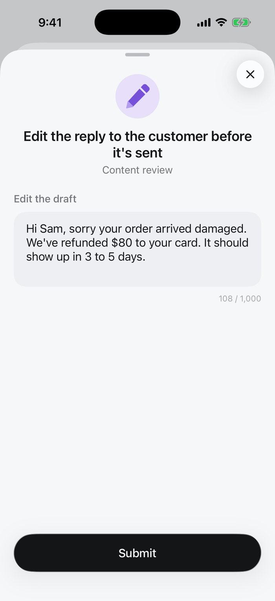

Reviewers get a draft, usually written by an AI step or your agent, and edit it before submitting. The run gets the final text.

<Frame>

</Frame>

## Set it up

In the review step, click **Edit request** and choose **Editable draft** under **Answer**. Set the draft text. It can come from the input (`{{trigger.body.draft}}`) or from an AI step (`{{ai.result}}`).

Over the API or MCP, set the review step's `responseType` to `editable_text` and these fields in `responseConfig`:

| Field | |
|---|---|
| `draft_text` | The text reviewers start from |
| `max_length` | Most characters |
| `required` | The reviewer must answer to submit |

```json
{
  "type": "review",
  "data": {
    "requestText": "...",
    "responseType": "editable_text",
    "responseConfig": {"draft_text": "{{ai.result}}", "max_length": 1000, "required": true}
  }
}
```

## What the run gets

The answer is the decision of the step, and `result` if it is the last review:

```json
{"decision": "Hi Sam, sorry your order arrived damaged. We've refunded $80 to your card...", "reviewer_name": "Priya Shah", "platform": "mobile"}
```

Send it with an action step: an email or Slack message whose body is `{{response.value}}`.

[All answer types](/responses/types)
