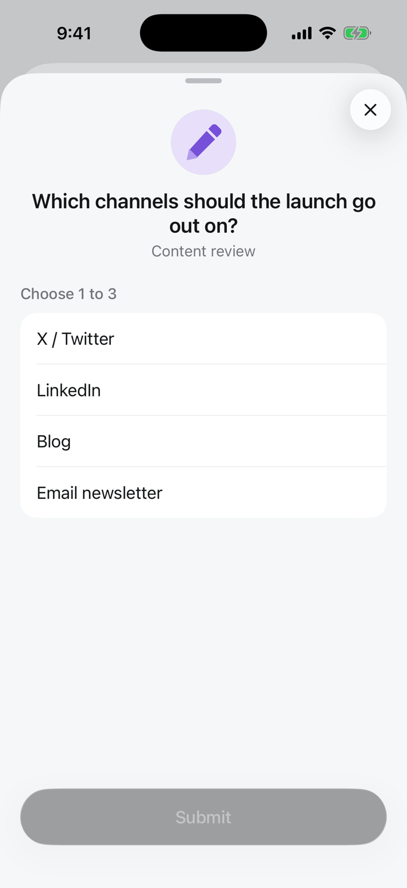

Reviewers tick any number of options. The run gets the list of chosen values.

<Frame>

</Frame>

## Set it up

In the review step, click **Edit request** and choose **Multiple choice** under **Answer**. Add options as for single choice, and optionally limit how many can be picked.

Over the API or MCP, set the review step's `responseType` to `multi_select` and these fields in `responseConfig`:

| Field | |
|---|---|
| `options` | Required. `[{"label": "LinkedIn", "value": "linkedin"}, ...]` |
| `min_selections` | At least this many |
| `max_selections` | At most this many |
| `required` | The reviewer must answer to submit |

```json
{
  "type": "review",
  "data": {
    "requestText": "...",
    "responseType": "multi_select",
    "responseConfig": {"options": [{"label": "X / Twitter", "value": "x"}, {"label": "LinkedIn", "value": "linkedin"}, {"label": "Blog", "value": "blog"}, {"label": "Email newsletter", "value": "newsletter"}], "min_selections": 1, "max_selections": 3, "required": true}
  }
}
```

## What the run gets

The answer is the decision of the step, and `result` if it is the last review:

```json
{"decision": ["linkedin", "blog"], "reviewer_name": "Priya Shah", "platform": "mobile"}
```

Use `contains` in a condition to branch on one value: `response.value contains blog`.

[All answer types](/responses/types)
