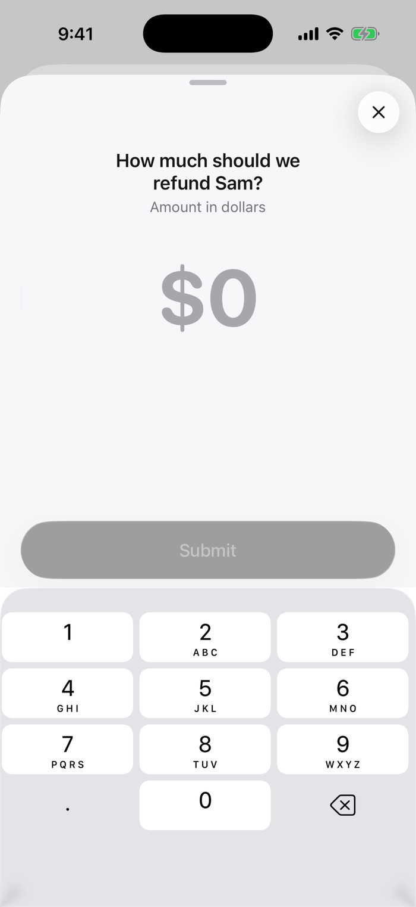

Reviewers type a number on a number pad. The run gets the number.

<Frame>

</Frame>

## Set it up

In the review step, click **Edit request** and choose **Number** under **Answer**. Optionally limit the range.

Over the API or MCP, set the review step's `responseType` to `number` and these fields in `responseConfig`:

| Field | |
|---|---|
| `min_value` | Smallest allowed |
| `max_value` | Largest allowed |
| `placeholder` | Hint, such as *Amount in dollars* |
| `required` | The reviewer must answer to submit |

```json
{
  "type": "review",
  "data": {
    "requestText": "...",
    "responseType": "number",
    "responseConfig": {"min_value": 0, "max_value": 500, "required": true}
  }
}
```

## What the run gets

The answer is the decision of the step, and `result` if it is the last review:

```json
{"decision": 80, "reviewer_name": "Priya Shah", "platform": "mobile"}
```

Use it in an action, for example a refund webhook with `"amount": {{response.value}}`.

[All answer types](/responses/types)
