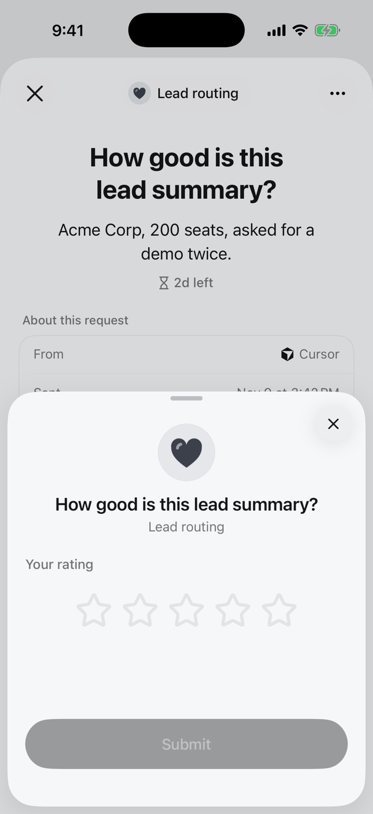

Reviewers tap a score on a scale. The run gets the number.

<Frame>

</Frame>

## Set it up

In the review step, click **Edit request** and choose **Rating** under **Answer**. Set the scale.

Over the API or MCP, set the review step's `responseType` to `rating` and these fields in `responseConfig`:

| Field | |
|---|---|
| `scale_min` | Lowest score. Default 1 |
| `scale_max` | Highest score. Default 5 |
| `scale_step` | Step between scores |
| `required` | The reviewer must answer to submit |

```json
{
  "type": "review",
  "data": {
    "requestText": "...",
    "responseType": "rating",
    "responseConfig": {"scale_min": 1, "scale_max": 5, "required": true}
  }
}
```

## What the run gets

The answer is the decision of the step, and `result` if it is the last review:

```json
{"decision": 4, "reviewer_name": "Priya Shah", "platform": "mobile"}
```

Branch on quality: `response.value less_than 3` sends weak results back.

[All answer types](/responses/types)
