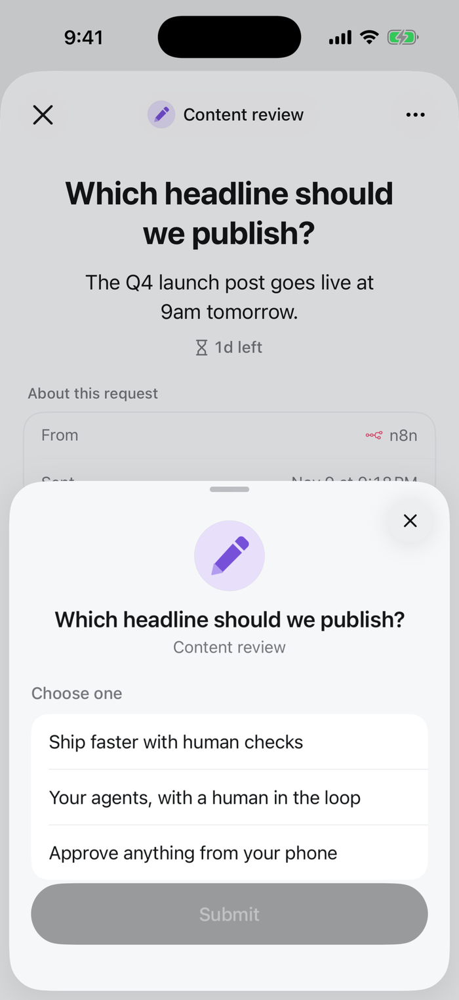

Reviewers pick one option from a list. The run gets the option's value.

<Frame>

</Frame>

## Set it up

In the review step, click **Edit request** and choose **Single choice** under **Answer**. Add options under **Options**: each has a label (what reviewers see) and a value (what the run gets). **Add Option** adds one; up to 10 work well on a phone.

Over the API or MCP, set the review step's `responseType` to `single_select` and these fields in `responseConfig`:

| Field | |
|---|---|
| `options` | Required. `[{"label": "Approve refund", "value": "approve"}, ...]` |
| `required` | The reviewer must answer to submit |

```json
{
  "type": "review",
  "data": {
    "requestText": "...",
    "responseType": "single_select",
    "responseConfig": {"options": [{"label": "Approve refund", "value": "approve"}, {"label": "Deny", "value": "deny"}, {"label": "Escalate to manager", "value": "escalate"}], "required": true}
  }
}
```

## What the run gets

The answer is the decision of the step, and `result` if it is the last review:

```json
{"decision": "approve", "reviewer_name": "Priya Shah", "platform": "mobile"}
```

Branch on it with a condition: `response.value equals approve`. A single choice with *Approve* / *Deny* / *Escalate* is the most common review step.

[All answer types](/responses/types)
