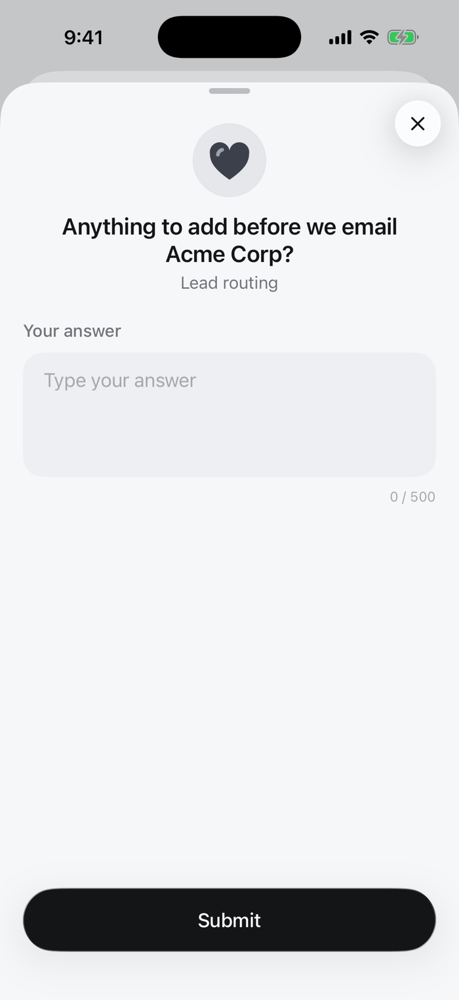

A free-text box. The run gets what the reviewer wrote.

<Frame>

</Frame>

## Set it up

In the review step, click **Edit request** and choose **Text** under **Answer**. Set a placeholder and length limits.

Over the API or MCP, set the review step's `responseType` to `text` and these fields in `responseConfig`:

| Field | |
|---|---|
| `placeholder` | Hint shown in the empty box |
| `min_length` | Fewest characters |
| `max_length` | Most characters (the app shows a counter) |
| `required` | The reviewer must answer to submit |

```json
{
  "type": "review",
  "data": {
    "requestText": "...",
    "responseType": "text",
    "responseConfig": {"placeholder": "Type your answer", "max_length": 500, "required": false}
  }
}
```

## What the run gets

The answer is the decision of the step, and `result` if it is the last review:

```json
{"decision": "Mention the onboarding call on Thursday.", "reviewer_name": "Priya Shah", "platform": "mobile"}
```

Feed it to a later AI or action step as `{{response.value}}`.

[All answer types](/responses/types)
