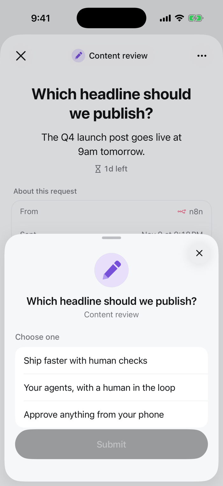
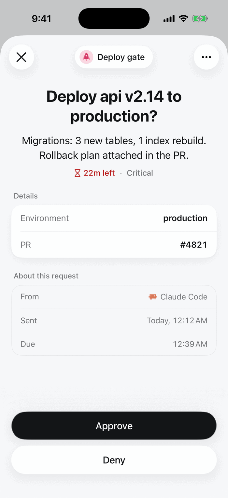
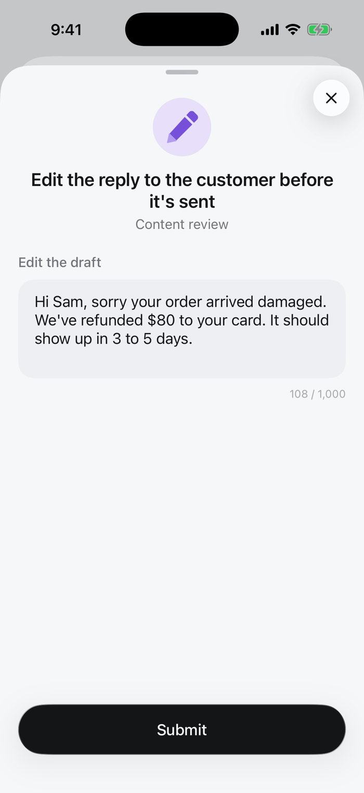

Each review step asks for one kind of answer. Pick it under **Answer** in the step's **Edit request** dialog; over the API it is the step's `responseType` with its settings in `responseConfig`.

| Editor | `responseType` | Reviewers | The run gets | Use it for |
|---|---|---|---|---|
| [Approve / Deny](/responses/boolean) | `boolean` | Two buttons | `true` / `false` | Yes-or-no gates |
| [Single choice](/responses/single-select) | `single_select` | One of a list | The option's `value` | Approve, deny or escalate; pick a version |
| [Multiple choice](/responses/multi-select) | `multi_select` | Several of a list | A list of values | Tags, channels, checklists |
| [Text](/responses/text) | `text` | A text box | The text | Notes, reasons, instructions |
| [Editable draft](/responses/editable-text) | `editable_text` | A draft to edit | The edited text | An agent's reply checked before it is sent |
| [Rating](/responses/rating) | `rating` | Stars on a scale | A number | Quality scores |
| [Number](/responses/number) | `number` | A number pad | A number | Amounts, quantities, estimates |

<Columns cols={3}>
<Frame caption="Single choice">

</Frame>
<Frame caption="Approve / Deny">

</Frame>
<Frame caption="Editable draft">

</Frame>
</Columns>

## Settings every type has

| Setting | `responseConfig` | |
|---|---|---|
| Required | `required` | The reviewer must answer to submit (default on) |
| Deadline | step `timeout` (seconds) | How long people have. After it, the step's default answer is used, or the run times out |

The answer is stored in the execution's `decisions[].decision` and, for the last review step, `result`. Later steps read it as `{{response.value}}`, for example in a condition `response.value equals approve`.

## What the question can show

The question is Markdown and can include fields from the input. A review step can also attach an image, document, video or audio file. See [Content](/responses/content-types).
